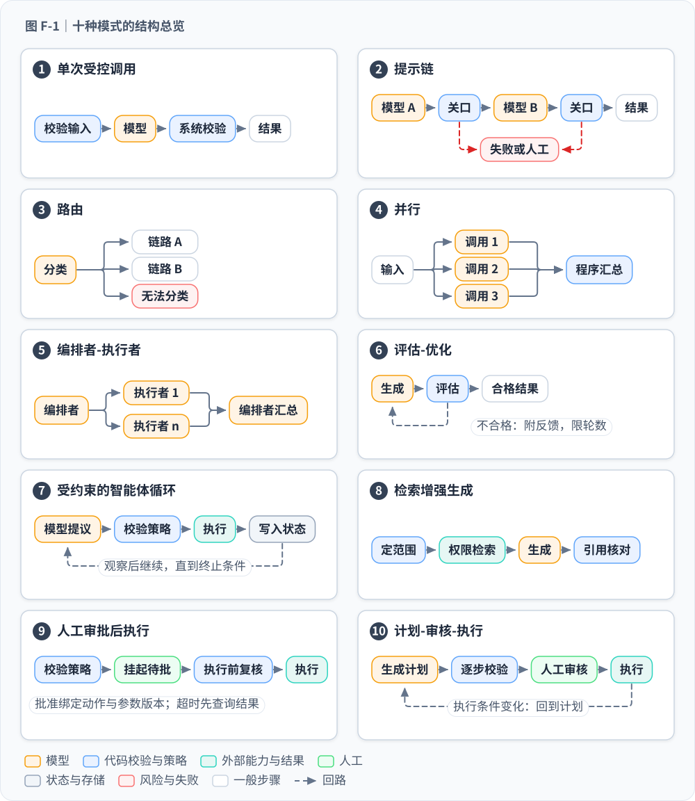
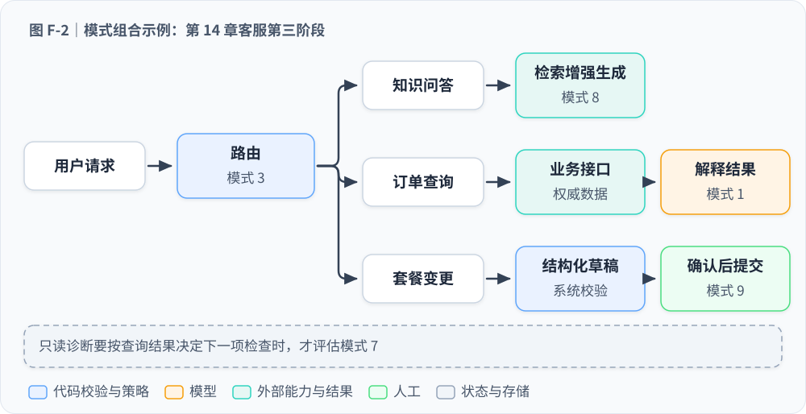

# 附录 F 模式速查

本附录收录十种常用的控制与组合模式，供设计评审时查找。每个模式按同一顺序说明：结构、适用信号、后端对应、主要风险、控制要点和详见章节。首次阅读时，可以先看模式 1—3 和 F.2 的选择表；其余模式在学完相应章节后回看。

模式 2—6 的名称与定义采用 Anthropic 工程文章 [Building effective agents](https://www.anthropic.com/engineering/building-effective-agents)；模式 7 对应该文的 Agents 一节，“受约束”是本书加的限定。该文章说明，这些模式可以按用途组合和调整，并建议只在能证明改善结果时增加复杂度。模式 8 的名称沿用 Lewis 等人的论文。模式 1、8、9、10 的结构描述，以及每个模式的后端对应、风险与控制要点，是本书为设计讨论整理的内容。

## F.1 十种模式的结构

**读图**：橙色节点由模型完成，蓝色节点是代码检查或策略，青色节点访问外部系统，绿色节点由人负责，灰色节点保存状态，红色节点表示失败或无法处理的出口，白色节点是一般步骤。虚线箭头表示回路。比较模式 6、7、10 可以看到，三者都有回路，但回路的起点和允许改变的内容不同。

### 模式 1 单次受控调用

- **结构**：输入校验 → 上下文组装 → 模型 → 系统校验 → 结果或明确的失败状态。
- **适用信号**：材料已经给定，只需完成分类、抽取、摘要、改写或受约束的生成。
- **后端对应**：调用一个外部服务的普通业务函数。
- **主要风险**：输出格式合法但内容错误；材料不足时编造内容。
- **控制要点**：系统校验；把“材料不足”设计成合法返回值；记录模型与提示版本。
- **详见**：[第 4 章](../part-2/04-model-integration.md)、[第 5 章](../part-2/05-first-ai-application.md)。

这是首选的起点。Anthropic 的文章指出，对许多应用而言，优化单次模型调用（配合检索和上下文示例）通常已经足够。

### 模式 2 提示链（Prompt chaining）

- **结构**：步骤 A（模型）→ 关口检查（代码）→ 步骤 B（模型）→ 关口检查（代码）→ 结果；任何关口不通过，进入失败或人工处理。
- **定义**：把任务拆成一串固定步骤，每次模型调用处理上一步的输出；可以在中间步骤加入程序化检查（关口）。
- **适用信号**：任务能干净地拆成固定子任务，每一步因此变得更简单。这种模式用更高的延迟换取更高的准确性。
- **后端对应**：管道与过滤器。
- **主要风险**：前一步的错误传递到后续步骤；中间结果的格式不匹配。
- **控制要点**：每个关口用代码检查格式和业务约束；保存中间结果，便于定位出错的步骤。
- **详见**：[第一篇小结 P1.4 节“第二组：方案”中的填报示例](../part-1/reference-architecture.md)。

### 模式 3 路由（Routing）

- **结构**：输入 → 分类（模型或传统分类器）→ 处理链路 A、B、C，或“无法分类”出口。
- **定义**：对输入分类，再交给专门的后续处理。不同链路可以使用不同的流程、提示、工具或模型。
- **适用信号**：输入有几类明显不同、分开处理效果更好的类型，并且分类本身可以做得准确。
- **后端对应**：请求分发、策略模式。
- **主要风险**：误分类把请求送进错误链路，例如把业务办理请求当成知识问答。
- **控制要点**：设置“无法分类”出口；用各类真实样例分别评测分类；界面已经能让用户选择入口时，直接用入口分流。
- **详见**：[第 14 章](../part-4/14-knowledge-and-support.md)。

### 模式 4 并行（Parallelization）

- **结构**：输入同时交给调用 1、调用 2、调用 3，再由程序汇总。
- **定义**：多个模型调用同时处理任务，由程序汇总输出。有两种变体：分段，把任务拆成独立子任务并行执行；投票，多次运行同一任务以获得多样的输出。
- **适用信号**：子任务相互独立，并行可以缩短耗时；或者任务需要从多个方面分别检查。
- **后端对应**：扇出与汇合（scatter-gather）。
- **主要风险**：部分调用失败时汇总规则不清；投票的多次调用使用相同材料，结果一致仍算不上多份独立证据（第 3 章 3.7 节）；调用成本成倍增加。
- **控制要点**：写明部分失败时是否允许汇总；按关键路径估算延迟（第 2 章 2.7 节）。
- **详见**：[第 2 章](../part-1/02-architecture-matrix.md)、[第 3 章](../part-1/03-design-principles.md)、[第 22 章](../part-5/22-gateway-cost.md)（撰写中）。

### 模式 5 编排者-执行者（Orchestrator-workers）

- **结构**：编排者（模型）动态拆分任务 → 执行者 1..n（模型）→ 编排者汇总。
- **定义**：一个中心模型动态拆分任务，委派给执行者模型，再综合它们的结果。与并行模式的区别在于，子任务由编排者根据具体输入决定，而非预先定义。
- **适用信号**：无法预知需要哪些子任务，例如一次代码修改要改动多少个文件，取决于具体任务。
- **后端对应**：主从调度，但任务拆分由模型完成。
- **主要风险**：拆分遗漏或重复；子任务数量和成本难以预估；汇总时丢失结论来源。
- **控制要点**：限制子任务数量和总预算；每个子任务的结果带来源；汇总结论回到证据核对。
- **详见**：[第 13 章](../part-3/13-multi-agent.md)（撰写中）。

### 模式 6 评估-优化（Evaluator-optimizer）

- **结构**：生成（模型）→ 评估（模型或程序）→ 合格则输出结果；不合格时附反馈回到生成，并设最大轮数。
- **定义**：一次模型调用生成结果，另一次调用评估并给出反馈，循环进行。
- **适用信号**：有清晰的评价标准，迭代改进能带来可测量的价值。Anthropic 给出两个判断标志：人提出反馈后结果能明显改善；模型能够给出这类反馈。
- **后端对应**：代码评审与修改的循环。
- **主要风险**：评估者的输出同样是生成内容，可能与生成者有相同偏差；循环不收敛。
- **控制要点**：把评价标准写成检查项；能由程序判断的项（格式、引用、测试结果）交给程序；设置最大轮数和停止后的出口。
- **详见**：[第 6 章](../part-2/06-evaluation-basics.md)、[第 20 章](../part-5/20-eval-observability.md)（撰写中）。

### 模式 7 受约束的智能体循环（Agent loop）

- **结构**：模型提议动作 → 校验与策略 → 工具执行 → 观察结果写入状态，循环进行；在完成并通过验收、预算耗尽、无进展或需要人工时终止。
- **定义**：模型根据环境反馈，在循环中使用工具。每一步都需要从环境获得可核对的结果（例如工具返回或代码执行结果）来判断进展。ReAct（Yao 等，2022）是交替生成推理和行动的代表性方法。[ReAct 论文](https://arxiv.org/abs/2210.03629)
- **适用信号**：开放式问题，所需步数难以预测，路径无法写死；环境能在每一步提供可靠反馈。
- **后端对应**：可以理解为由模型选择转移的状态机，允许的状态、动作和终止条件仍由代码持有。
- **主要风险**：偏离目标、重复循环、越权、成本累积，以及错误逐步叠加。
- **控制要点**：工具白名单和参数策略；步数、时间、Token 和工具调用分别设预算；检测无进展；由运行时决定是否真正完成。
- **详见**：[第 1 章](../part-1/01-software-laws.md)、[第 10 章](../part-3/10-agent-loop.md)（撰写中）、[第 11 章](../part-3/11-task-state.md)（撰写中）。

### 模式 8 检索增强生成（RAG）

- **结构**：问题与身份 → 确定适用范围 → 按权限检索 → 选取适用材料 → 基于材料生成 → 引用核对 → 回答或说明缺口。
- **名称来源**：这一名称来自 Lewis 等人 2020 年的论文，原文方法包含检索器与生成模型的联合训练。[RAG 论文](https://arxiv.org/abs/2005.11401) 工程中通常泛指“先检索、再基于材料生成”的应用结构，本书采用后一种用法。
- **适用信号**：回答需要模型参数之外、可以从文档获得、并且会更新的知识。
- **适用边界**：实时业务状态（订单、余额、库存）应调用权威业务接口，留在文档索引之外（第 14 章）。
- **后端对应**：搜索服务加结果展示。
- **主要风险**：没有检索到材料，或检索到不适用的版本；回答没有忠实使用材料；跨权限泄露。
- **控制要点**：检索前按权限过滤；保留文档版本与适用范围；检索质量和生成质量分开评测。
- **详见**：[第 9 章](../part-2/09-rag-knowledge.md)（撰写中）、[第 14 章](../part-4/14-knowledge-and-support.md)。

### 模式 9 人工审批后执行（Human-in-the-loop）

- **结构**：动作提议 → 校验与策略 → 判断是否需要审批。不需要时直接执行并核对结果；需要时挂起并保存状态，人工批准（绑定动作与参数版本）后，执行前复核条件，再执行并核对结果。
- **适用信号**：动作有副作用，并且错误代价高、难以恢复，或者业务规则本身要求审批。
- **后端对应**：审批流。
- **主要风险**：批准没有绑定具体动作，批准后参数被修改；批准已经过期；需要审批的事项过多，审阅流于形式。
- **控制要点**：批准记录绑定动作、资源、参数版本和有效条件；执行前重新核对；超时后按操作标识查询结果，再决定是否重试。
- **详见**：[第 3 章](../part-1/03-design-principles.md)、[第 12 章](../part-3/12-durable-execution.md)（撰写中）、[第 19 章](../part-4/19-process-automation.md)（撰写中）。

### 模式 10 计划-审核-执行

- **结构**：模型生成结构化计划 → 程序逐步校验 → 人工审核（按需）→ 工作流按计划执行；执行条件变化时回到计划阶段。
- **适用信号**：要执行的步骤取决于用户意图，无法预先定义；执行前可以看清全部步骤，并且执行会产生副作用。
- **与模式 7 的区别**：动态性集中在计划阶段；执行阶段由工作流按已审核的计划推进，执行中不再自行增加步骤。
- **后端对应**：先预览变更、再提交执行，类似数据库迁移先审阅脚本再执行。
- **主要风险**：计划依据的信息在执行时已经变化；计划看起来完整，却遗漏了前提条件。
- **控制要点**：计划使用结构化格式，每一步单独校验；执行前复核关键条件；偏离计划时停止并回到计划阶段。
- **详见**：[第 12 章](../part-3/12-durable-execution.md)（撰写中）、[第 15 章](../part-4/15-cross-system-execution.md)。业界对这类形态有不同名称，实现差异较大，这里描述的是本书采用的形态。

## F.2 按需求特征选择模式

| 观察到的需求特征 | 先考虑 | 暂不考虑 |
| --- | --- | --- |
| 材料已经给定，需要理解或生成 | 1 单次受控调用 | 智能体循环 |
| 能拆成固定几步，每步可以检查 | 2 提示链 | 编排者-执行者 |
| 请求有几类明显不同的处理方式 | 3 路由 | 用一个提示处理所有类型 |
| 有多个独立子任务，或需要多方面检查 | 4 并行 | 串行链路 |
| 子任务无法预知，需要先拆分 | 5 编排者-执行者 | 多个固定角色互相对话 |
| 有清晰的评价标准，修改能改善结果 | 6 评估-优化 | 没有评价标准的反复改写 |
| 下一步取决于上一步的观察 | 7 受约束的智能体循环 | 无约束的自由循环 |
| 需要模型之外、会更新的文档知识 | 8 检索增强生成 | 把实时业务数据写进文档索引 |
| 动作有副作用，代价高或要求审批 | 9 人工审批后执行 | 用提示词禁止危险操作 |
| 步骤按意图生成，执行前可以看清 | 10 计划-审核-执行 | 边想边执行的循环 |

这张表用于确定第一个候选。选定以后，仍要按标准一页方案的第 10—12 项设计评测、预算和最小实验（[第 2 章 2.4 节](../part-1/02-architecture-matrix.md)）。

## F.3 模式可以组合

一个应用通常组合多个模式。图 F-2 以第 14 章客服案例的第三阶段为例。

**读图**：路由只负责把请求分到三条链路，每条链路再采用各自的模式。订单查询的数据来自业务接口，模型只解释结果；套餐变更的提交由用户确认。只有在诊断型客服必须根据查询结果决定下一项检查时，才在只读范围内评估模式 7。

组合时遵守一条规则：**每加入一个模式，都要能说出它解决了评测中的哪一类失败。**

## F.4 一页速查卡

**标准一页方案的十二项**（定义见[第 2 章 2.4 节](../part-1/02-architecture-matrix.md)，空白表见[附录 E](templates/one-page-design.md)）：

1. 任务与交付物：谁、在什么时点、拿到什么、用来做什么。
2. 错误后果与边界：错误代价分级；不可越过的边界。
3. 无需模型的基线：规则、查询、搜索、模板能做到什么，剩下的缺口是什么。
4. 模型职责：写成“动词 + 对象”，并写明模型不做什么。
5. 控制方式：选定的方式与模式，以及不选其他方案的理由。
6. 信息获取：材料来源、权限与时效。
7. 数据处理：敏感性、处理位置、第三方传输与留存。
8. 动作与授权：只读、可逆写或不可逆写；谁授权，是否审批。
9. 状态与失败：每种失败对应一个应用状态；结果不明时先查询再决定。
10. 评测验收：样例、判定方法与人工责任。
11. 成本与延迟：估算假设与测量方法。
12. 最小实验与改变条件：什么结果会推翻当前选择，什么需求变化会改变架构。

**三条底线**：

- 模型输出是提议，执行权留在系统。
- 授权、审批与提交在模型之外完成。
- 每增加一个模式或组件，都要有评测证据支持。

## 资料与适用范围

Anthropic 工程文章于 2026 年 10 月 21 日核对。该文章发表于 2024 年 12 月，页面注明文中提到的工具生态此后已有变化；本附录只引用其中的模式定义与适用条件。ReAct 与 RAG 按原论文说明名称来源，不引用其实验数据。各模式的后端对应、风险与控制要点为本书的设计方法，没有对应的实验结论。
