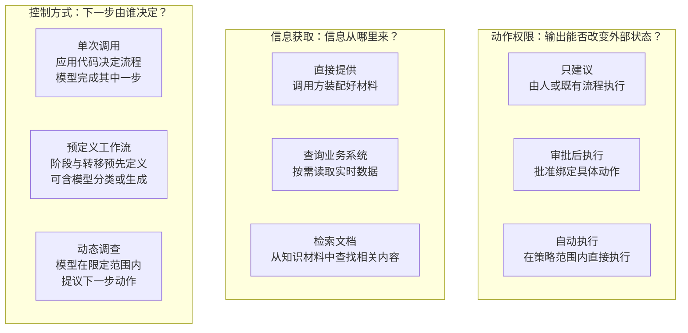
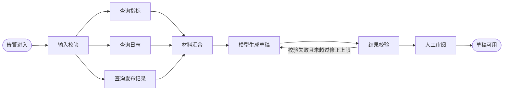
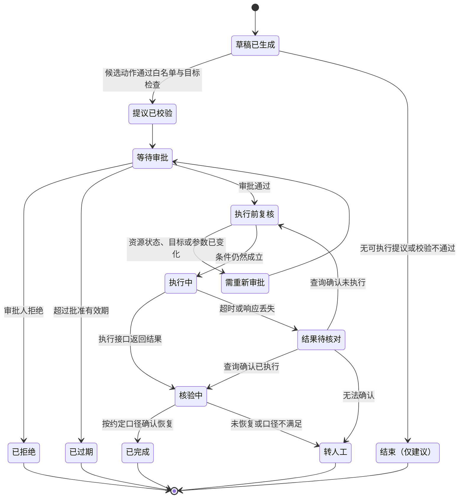

# 第 2 章增强稿：一页方案、独立维度与需求变化

> 稿件说明（作者工作稿，未纳入 SUMMARY.md）：本文是对现有第 2 章 `part-1/02-architecture-matrix.md` 的增强稿，写作与资料核验日期 2026 年 10 月 15 日；同日按审稿意见补充了第 4 项的数据敏感级别与处理位置、第 6 项的低把握结果去向，以及第 7 项影响具体个人时的公平性检查。现有 2.1—2.7 节（任务拆分、成功标准、控制方式、数据与动作边界、反馈与退出、ADR、验证计划）全部保留，本文只提供新增内容和建议插入位置，不替换原文。文中的运维助手方案、ADR-002、状态图与练习参考思路均为本书的教学设计，不是已经完成的生产项目或实验结果。
>
> 建议插入位置：
>
> - “三段对照”放在章首引言之后、2.1 之前。
> - 2.8 一页方案模板、2.9 三个独立的选择维度、2.10 成本与延迟的估算与测量、2.11 按职责划分模型的位置、2.12 运维助手的一页方案、2.13 需求变化，依次放在现有 2.7 之后、“本章小结”之前。现有 2.3 末尾可增加一句指向图 2-1 的交叉引用。
> - 章末练习：建议保留现有 4 道思考题，另增“陌生需求练习”一节。

---

## 章首：三段对照

**已有经验。** 你已经会拆分需求、评审方案、写架构决策记录，也知道一个设计要说明数据从哪里来、谁有权限、失败后怎么办。这些能力在本章全部用得上。

**新增问题。** 引入模型后，“用不用模型、怎样控制流程、信息从哪里来、允许系统做什么”需要分别回答，它们彼此独立，不能用一个“上 Agent”或“上 RAG”的决定一次带过。同时，成功标准需要写在方案之前，因为模型生成的结果“看起来不错”不等于任务完成。

**本章产出。** 一份针对具体需求的一页方案，覆盖九项内容，并配一份 ADR 记录关键取舍和需要实验验证的假设。

---

## 2.8 一页方案模板

前面几节分别讨论了任务拆分、成功标准、控制方式、边界、退出机制和决策记录。实际工作中，需要一份文档把它们汇总起来，让需求方、开发者和审阅者在同一页纸上讨论。本书把它称为“一页方案”。

一页方案与 ADR 的分工是：一页方案描述整个系统在当前阶段的设计全貌，ADR 记录其中某一项关键取舍的理由。一页方案中凡是“为什么这样选”需要较长解释的地方，可以链接到对应的 ADR。

“一页”是对篇幅的约束，不是格式要求。它的目的是迫使作者写出结论和未知项，而不是堆积背景材料。每一项都允许写“未知”，但必须写明需要向谁确认、用什么方法验证。

| 项目 | 要回答的问题 | 写不出来时通常意味着 |
| --- | --- | --- |
| 1. 任务与价值 | 系统负责哪一段工作？在什么时点、为谁、交付什么？明确不负责什么？价值体现在哪里，如何判断它是否成立？ | 需求还停留在技术名称上，需要回到 2.1 拆分任务 |
| 2. 是否需要模型 | 哪些环节可以用规则程序完成？哪些环节需要模型的理解或生成能力？不用模型的基线方案是什么？ | 还没有区分职责，模型可能被放在了不需要它的位置 |
| 3. 控制方式 | 用到模型的环节，流程由谁决定：单次调用、预定义工作流，还是动态调查？为什么不选另外两种？ | 还不清楚任务路径能否预先确定 |
| 4. 信息获取 | 模型需要哪些信息？由调用方直接提供、查询业务系统，还是检索文档？谁有权读取？信息有多新？这些数据的敏感级别如何，允许在哪里处理，能否发给外部模型服务？ | 数据来源和读取权限尚未落实；部署方式（外部 API、私有化部署或混合）还没有依据 |
| 5. 动作与权限 | 系统会不会改变外部状态？每个动作是只建议、审批后执行，还是自动执行？使用什么凭证？谁有资格审批？ | 副作用和授权边界没有设计 |
| 6. 状态与失败 | 哪些状态由应用维护，存在哪里？有哪些失败路径，每种失败后用户得到什么？动作结果不明时怎么办？抽取或判断结果把握低时去向哪里：哪些字段必须逐项核对，什么情况转人工复核，运行时怎样分流？ | 只设计了成功路径；默认每一条模型结果都可以直接使用 |
| 7. 验收方法 | 什么算一次任务通过，分母是什么？哪些由程序检查，哪些用模型辅助评分，哪些需要人工判断？与基线怎样比较？如果判断影响具体的人：公平性怎么检查，按哪些人群分组比较结果，如何排查代理变量，多久复查一次？ | 成功标准尚未定义，后续无法比较方案；结果影响具体的人，却没有检查不同人群之间的差异 |
| 8. 资源预算 | 每个任务包含哪些模型调用、工具调用、可能的重试和人工处理？成本和延迟怎样估算，在哪里测量？ | 只算了模型调用，或者用了没有依据的数字 |
| 9. 验证计划 | 方案依赖哪些尚未证实的假设？按什么顺序验证？哪种结果会让我们放弃当前方案或推迟增加复杂度？ | 方案还不能被证据推翻，仍是技术愿望 |

### 填写时的几条约定

**区分事实、假设与约定。** 延续 2.1 的做法，关键前提标明状态：已经确认、尚待验证、由项目约定。例如“告警平台能提供服务标识”是可确认的事实，“草稿能缩短调查时间”是待验证假设，“第一版不执行写操作”是项目约定。

**第 2 项与第 3 项分开填写。** 第 2 项回答“哪些环节需要模型”，第 3 项只针对需要模型的环节回答“流程由谁控制”。规则程序完成的环节不必出现在第 3 项里。

**第 3、4、5 项各自独立选择。** 下一节会说明，这三项不是同一个选择的不同档位。

**第 8 项写方法和口径，不写普适数字。** 在没有测量之前，预算项写成“由哪些部分组成、怎样估算、在哪里测量”，估算值标明是待验证的假设。

**第 9 项至少写一个放弃条件。** 与 2.7 的第四个问题对应：哪个结果会让我们放弃当前方案。

### 第 4 项补充：数据敏感级别与处理位置

信息获取不只回答“数据从哪里来”，还要回答“数据可以到哪里去”。模型调用意味着把输入发送给某个推理服务；如果这个服务由外部提供，数据就离开了你直接控制的环境。因此第 4 项需要多回答三个问题：

1. **敏感级别。** 输入中包含哪些类别的数据，按组织的数据分类分级规则属于哪一级？是否含有个人信息、凭证密钥、客户数据或内部系统细节？
2. **允许的处理位置。** 按组织规定和合同约定，这一级别的数据允许在哪里处理：仅限内网、仅限自有或指定的云环境，还是可以交给经过评估的外部服务？处理结果和日志允许保存在哪里、保存多久？
3. **能否发给外部模型服务。** 如果可以，需要满足什么条件，例如签订数据处理协议、关闭服务方的数据留存、只发送脱敏后的内容？如果不可以，是全部不可以，还是只有部分字段不可以？

这一项的答案往往直接决定部署方式，有时比模型能力更早地把选项排除掉：

| 第 4 项的答案 | 常见的部署方式 | 需要另外验证的事项 |
| --- | --- | --- |
| 数据允许发送给经过评估的外部服务 | 调用外部模型 API | 服务方的数据留存与使用条款、所在地域、访问控制，以及组织内的评估结论 |
| 数据不允许离开指定环境 | 私有化部署模型，或使用部署在指定环境内的托管服务 | 可选模型的能力是否满足任务、算力与运维成本、版本更新方式 |
| 只有部分字段受限 | 混合：受限字段在本地处理或脱敏，其余内容交给外部服务；或按数据级别把请求路由到不同服务 | 脱敏是否破坏任务所需的信息、路由规则是否可靠、两条路径的结果是否需要分别评测 |

脱敏和路由应由确定性程序在调用模型之前完成，不能交给模型自己判断“哪些内容不该发出去”。脱敏后，评测也要用脱敏后的输入进行，因为被遮盖的信息可能正是任务需要的证据。

**法规提醒（有条件适用）。** 以下只是提醒，不是法律意见，也不表示每个项目都必须办理某项手续。如果应用在中华人民共和国境内处理自然人的个人信息，并打算把含个人信息的输入发送给外部模型服务，就需要与法务或合规团队确认：这种发送在《个人信息保护法》下属于委托处理（第二十一条），还是向其他个人信息处理者提供（第二十三条）；输入中是否含有第二十八条所列的敏感个人信息；如果服务方在境外处理数据，还需对照第三章“个人信息跨境提供的规则”（第三十八至四十三条），其中第三十八至四十条分别规定向境外提供的条件、向个人告知并取得单独同意、特定处理者的境内存储与安全评估；第五十五条列出的情形（包括处理敏感个人信息、利用个人信息进行自动化决策、委托处理、向境外提供）需要事前进行个人信息保护影响评估。是否适用、适用哪一条、有无豁免，取决于数据类别、数量、处理者身份和服务方所在地等条件，应以合规团队的判断为准。条文依据中国人大网刊载的法律文本，于 2026 年 10 月 15 日核对；国家网信部门的配套规定本书未核验，也未查证该法此后是否修订。如果你的应用不处理个人信息，或不在上述法律的适用范围内，这一提醒不适用，但组织自身的数据分级规定仍然适用。

### 第 6 项补充：低把握结果的去向

一套整体上达标的系统，仍然会产生单条错误的结果。第 6 项除了处理“调用失败”，还要处理“调用成功了，但这一条结果不够可靠”的情况。需要回答三个问题：

1. **哪些字段必须逐项核对。** 列出一旦出错就会造成实际影响的关键字段，例如数值、时间、标识符、引用来源。对这些字段规定逐项核对的方法：与输入原文比对、与记录系统比对、用格式和校验规则检查。核对不通过的字段不能被下游直接使用。
2. **什么情况算“把握低”，转给谁复核。** 不以模型自报的置信度数字作为依据（第 3 章已说明它不能直接解释为正确概率），而用可以观察的信号：关键字段核对不通过、引用的证据不存在或互相矛盾、输入材料不完整、模型明确表示信息不足、需要时对同一输入的多次生成结果不一致。满足这些条件的结果转人工复核，并写明复核人是谁、复核时能看到哪些材料。
3. **运行时如何分流。** 为每一条结果规定去向，例如：全部核对通过 → 正常交付；非关键部分存疑 → 交付但标明需核对的位置；关键字段核对不通过或证据冲突 → 不交付该结果，转人工复核队列；输入本身不合约定 → 退回调用方补充。分流规则写在代码里，并记录每条结果走了哪条路径。

**它与第 7 项验收的区别。** 第 7 项是上线前或每次版本变更前，在评测集上判断整套方案是否达标，结论是“这个版本能否上线”；它面向一批样例，离线进行。第 6 项的低把握去向是上线后对每一条真实结果的处理，结论是“这一条结果交给谁”；它面向单条输入，在运行时进行。两者都需要：评测通过不保证每条结果正确，所以需要运行时分流；反过来，分流规则是否有效，例如转人工的结果中是否确实集中了错误、直接交付的结果中是否漏过了错误，又需要在第 7 项的评测和上线后的抽样中检验。分流还会带来人工复核量，应计入第 8 项预算。

如果结果用于对个人作出筛选、评级等影响其权益的判断（见 2.11），分流的终点只能是人：即使全部核对通过，系统整理的依据也只交给有资格的决定者，不设“核对通过即自动生效”的路径。当事人提出申诉时，申诉进入单独的复核队列，由未参与原判断的人员处理，并记录复核人、依据和结论。

### 第 7 项补充：影响具体个人时的公平性检查

如果系统的输出会影响对具体个人的判断，第 7 项除了任务通过情况，还要回答“结果在不同人群之间是否存在不应有的差异”。这一问不适用于运维助手这类不对个人作判断的系统，但一旦适用，就不能用整体通过情况代替。可以从三方面检查：

1. **按人群分组比较结果。** 先确定需要比较的人群划分，划分依据来自适用法律、组织规则以及对受影响者的分析，而不是由开发者临时挑选。然后在评测集和上线后的抽样中，分组计算关键结果，例如被标为“依据不足”的比例、转人工的比例、人工最终决定与系统整理结论不一致的情况，以及各组的错误类型，并与整体结果对照。分组样本量较小时，差异可能只是随机波动，报告中应写明每组的样本量，不对小样本作强结论。进行分组比较往往需要知道样例所属的人群；为评测而使用这类属性，本身需要合法依据、访问控制和单独的保存规则，并且这些属性不得进入判断流程的输入。
2. **排查代理变量。** 从输入中删去不应使用的字段，并不保证结果与这些因素无关，其他字段可能间接反映它们，例如居住地区、某些称谓、时间信息或描述用语。排查方法包括：检查各输入字段与人群划分之间的关联；去掉或改写可疑字段后比较结果变化；构造只在与人群相关的表述上不同、其他内容相同的成对样例，观察结果是否改变。发现代理变量后，决定删除、改写还是保留并说明理由，记录在 ADR 中。
3. **定期复查。** 模型版本、提示、判断规则、检索材料或输入人群发生变化时，重新进行分组比较；没有变化时，也按约定周期对上线后的抽样复查。申诉记录是复查的重要输入：申诉集中出现在某类人群或某类依据上，本身就是需要调查的信号。

差异达到什么程度需要处置、由谁决定处置方式，应由业务、合规和能代表受影响者利益的人员事先约定并记录。本书不给出数值阈值，因为合理的标准取决于判断的性质、后果和适用规则。

**法规提醒（有条件适用）。** 以下只是提醒，不是法律意见。如果应用在《个人信息保护法》适用范围内，利用个人信息通过计算机程序自动分析、评估个人并进行决策（第七十三条第二项对“自动化决策”的定义），需要与法务或合规团队对照第二十四条：利用个人信息进行自动化决策，应当保证决策的透明度和结果公平、公正，不得对个人在交易价格等交易条件上实行不合理的差别待遇；通过自动化决策方式向个人进行信息推送、商业营销，应当同时提供不针对其个人特征的选项，或者向个人提供便捷的拒绝方式；通过自动化决策方式作出对个人权益有重大影响的决定，个人有权要求说明，并有权拒绝仅通过自动化决策的方式作出决定。第五十五条第二项还把利用个人信息进行自动化决策列为需要事前进行个人信息保护影响评估的情形。“由人作出最终决定”的设计能否使某一流程不属于“仅通过自动化决策的方式作出决定”，取决于人是否实际审查依据、能否改变结果等具体情况，应由合规团队判断，本书不作结论。条文依据中国人大网刊载的法律文本，于 2026 年 10 月 15 日核对。

---

## 2.9 三个独立的选择维度

讨论 AI 应用架构时，常见的一种说法是把方案排成一条阶梯：先是单次调用，再加检索，再加审批，最后是智能体。这条阶梯容易让人以为“越往后越先进”，也容易让人以为采用了其中一项就必须先具备前面所有项。

本书不采用这种说法。控制方式、信息获取和动作权限是三个独立维度，分别回答不同的问题：

- **控制方式**：下一步做什么，由谁决定？
- **信息获取**：模型需要的信息，从哪里来？
- **动作权限**：系统的输出，能在多大程度上直接改变外部状态？

检索属于信息获取维度，审批属于动作权限维度，智能体（动态调查）属于控制方式维度。它们之间不存在先后顺序。一个单次调用的应用可以检索文档；一个动态调查的智能体可以只输出建议，不执行任何动作；一个预定义工作流可以在审批后执行操作，而完全不检索文档。

图 2-1 把三个维度画成并列的三组选项。图中没有连接不同维度的箭头，因为一个维度上的选择不会自动决定另一个维度。

**图 2-1 架构选择的三个独立维度**（源文件：本节 mermaid 代码块）



图 2-1 中每组的三个选项也不是互斥的。一个系统可以在不同环节采用不同选择：材料主要由调用方提供，个别字段查询业务系统补齐；查询类动作自动执行，修改类动作审批后执行。一页方案中应按环节分别写明。

### 控制方式

这三种选择与 2.3 讨论的规则程序、模型调用、工作流、智能体相对应，只是这里限定在用到模型的环节。

| 选择 | 适合的情况 | 需要确认的条件 |
| --- | --- | --- |
| 单次调用 | 输入已经确定，模型完成分类、抽取、摘要或受约束的生成 | 输入是否充分，输出能否被校验 |
| 预定义工作流 | 有多个阶段，阶段之间的关系、分支、等待条件可以事先写出 | 分支是否覆盖真实情况，状态由谁维护 |
| 动态调查 | 下一步查什么、做什么，取决于上一步观察到的结果 | 工具反馈是否可靠，进展能否判断，预算与终止条件是否明确 |

### 信息获取

| 选择 | 适合的情况 | 需要确认的条件 |
| --- | --- | --- |
| 直接提供 | 调用方掌握材料，且材料范围可以事先确定 | 调用方能否稳定提供，缺失时如何表达 |
| 查询业务系统 | 需要实时或权威的业务数据，例如资源当前状态 | 接口是否存在，调用者是否有权读取，查询成本 |
| 检索文档 | 需要从较大的知识材料中找到与当前问题相关的部分 | 材料是否可靠、是否过期，检索质量如何单独评估 |

查询业务系统与检索文档的区别在于数据的地位：前者读取的是记录系统中的当前事实，后者找的是文档中的相关内容。需要权威当前值时，应查询业务系统，而不是检索可能过期的文档副本。

无论选择哪种信息获取方式，数据的敏感级别与允许的处理位置都要另外回答（见 2.8 第 4 项补充）。它不是图 2-1 中的第四档选项，而是对模型服务部署方式的约束。

### 动作权限

| 选择 | 适合的情况 | 需要确认的条件 |
| --- | --- | --- |
| 只建议 | 动作后果需要人判断，或者执行链路尚未建立 | 建议如何呈现，人如何采纳或拒绝 |
| 审批后执行 | 动作有明确的执行接口，但需要有资格的人逐次确认 | 审批绑定到具体动作与参数，执行前重新检查条件，结果如何核验 |
| 自动执行 | 动作在已有策略下本就允许自动执行，且可核验、可恢复 | 策略由谁制定，执行凭证的范围，异常时如何停止与接管 |

动作权限的选择主要取决于动作本身的性质和组织已有的授权规则，而不是模型能力。即使模型提出的动作通常是合理的，如果系统没有可靠的结果反馈、没有幂等或恢复手段，也不应提高动作权限。

### 维度之间的约束

三个维度相互独立，但并非可以任意组合而不付代价。某些组合会给其他项目带来额外要求，这些要求应在一页方案中写出来：

- 选择“审批后执行”或“自动执行”时，第 6 项“状态与失败”必须包含持久化的任务状态和“结果待核对”路径。
- 选择“动态调查”时，第 8 项预算需要说明步数、调用和时间的上限，第 7 项需要评测调查过程的终止是否合理。
- 选择“检索文档”时，第 7 项需要分别评估检索质量和回答质量。

这些是“选了 A 就要补上 B”的约束，不是“先有 A 才能有 B”的阶梯。

---

## 2.10 成本与延迟的估算与测量

本节只介绍估算和测量的方法，不给出任何普适数字。模型价格、令牌用量、工具耗时与人工处理时间都随服务提供方、模型版本、输入分布和组织情况变化，书中写下的数字很快会失效，也无法代表读者自己的场景。

### 成本：按来源分别计算

一个任务的资源消耗可以按来源拆开计算：

```text
单个任务的消耗 =
    模型调用：Σ（每次调用的输入用量 × 输入单价 + 输出用量 × 输出单价）
  + 工具调用：Σ（每次工具调用的费用或配额消耗）
  + 重试与修正：因网络重试、格式修正、重新生成而增加的上述消耗
  + 人工处理：审阅、修订、审批所花的时间 × 组织约定的人工成本口径
```

这不是精确的计费公式，而是一份清单，用来确保不遗漏某一类消耗。几点说明：

- **模型调用**的计费口径以所用服务的文档为准。例如部分服务对可复用的输入前缀有单独的缓存计价，部分服务按输入长度分段计价。查阅价格时记录核验日期和模型版本。
- **工具调用**包括查询日志、指标、检索服务等的费用或配额。有些工具不直接收费，但会占用共享资源，例如对日志系统的大范围查询，也应记入。
- **重试与修正**不要用一个固定比例估计，而是在测试中记录实际发生的次数和原因。
- **人工处理**在许多场景中不可忽略。审阅一份草稿、批准一个动作都需要时间，它们是方案成本的一部分，也是判断方案是否“值得”的依据之一。

评价方案时，比“单个任务的消耗”更有意义的是**每个成功任务的消耗**：

```text
每个成功任务的消耗 =
    一段时间内全部任务的消耗（包括失败、超时、被拒绝、被人工放弃的任务）
  ÷ 同期通过验收的任务数
```

分子必须包含失败任务，否则一个经常失败、需要反复重试的方案会显得比实际便宜。这与 2.2 中“调用失败不从分母中消失”是同一原则。

### 延迟：看关键路径

延迟的估算遵循与普通服务相同的原则：串行步骤的耗时相加，并行分支取最长的那条。决定端到端耗时的那条最长路径就是关键路径。

图 2-2 是一个示意：材料收集阶段并行查询指标、日志和发布记录，汇合后调用模型生成草稿，再经结果校验和人工审阅。

**图 2-2 并行流程中的关键路径（示意）**（源文件：本节 mermaid 代码块）



在这个流程中，三项查询并行，材料收集阶段的耗时取三者中最慢的一项，而不是三者之和。如果日志查询通常最慢，那么缩短指标查询不会改善端到端耗时。模型生成、结果校验和人工审阅是串行的，各自直接计入关键路径。校验失败后的修正会让模型生成和校验再走一遍，所以修正次数的分布直接影响延迟分布。

估算时还要注意两点：

- **区分系统处理时间与端到端时间。** 人工审阅或审批的等待时间往往不受系统控制，但它决定用户何时拿到结果。两者分开报告：前者用于定位技术瓶颈，后者用于判断使用价值。
- **动态调查的关键路径长度不固定。** 步数取决于每一步的观察结果，估算时只能给出范围，并通过上限控制最坏情况。步数上限不等于耗时上限，还需要单独设置时间预算。

### 测量：先估算，再在代表性输入上测量

在方案阶段，估算值是一项待验证的假设，应写进第 9 项验证计划。测量时建议：

1. **为每个步骤记录起止时间。** 用分布式追踪或结构化日志记录每次模型调用、工具调用、校验和人工操作的开始与结束，以及所属任务。
2. **记录每次模型调用的用量。** 如果所用服务在响应中返回用量信息，按其文档口径记录输入、输出及缓存相关用量，不要只靠事后账单反推。
3. **记录重试和修正的次数与原因。** 区分网络错误、限流、格式失败和内容校验失败。
4. **记录人工处理时间。** 至少记录审阅或审批的开始与完成时间；如条件允许，记录修订了哪些内容。
5. **用分布而不是平均值描述结果。** 报告中位数和高分位数，并说明样本来自哪些输入、哪个版本、什么时间段。
6. **在代表性输入上测量。** 输入长度和复杂度直接影响用量和耗时，只用简短的演示输入测得的结果不能外推到真实负载。

---

## 2.11 按职责划分模型的位置

讨论“哪些地方不该用模型”时，按行业或应用类型列清单并不准确：同一个行业里既有适合模型的环节，也有必须由确定性程序完成的环节。更有用的问法是：**这一项具体职责，需要的是什么能力，错误的后果由谁承担？**

下表按具体职责举例说明。模型在其中许多环节仍然可以参与，只是承担的部分不同。

| 具体职责 | 交给谁 | 模型可以承担的部分 | 理由 |
| --- | --- | --- | --- |
| 金额、比率、时间窗口等数值计算 | 确定性程序 | 把用户的自然语言描述转成结构化的计算参数，由程序计算；在报告中引用程序算出的结果 | 计算规则明确，结果必须可复现、可核对；让模型直接给出数值没有带来额外能力，却引入出错可能 |
| 账户余额、资源当前状态等权威数据 | 记录系统（数据库或业务系统） | 帮助用户把“我还剩多少”这类表达转成对记录系统的查询；把查询结果组织成易读的说明 | 自然语言可以帮用户表达查询，但不能让模型决定账户余额；权威值只能来自记录系统 |
| 告警去重与归并 | 规则程序（按服务、指纹、时间窗口） | 对规则无法归并的告警提出“可能相关”的建议，供人确认 | 归并规则可以明确表达；模型的相关性判断适合作为补充建议 |
| 用户是否有权读取某项数据 | 授权系统或策略引擎 | 不承担 | 授权是安全边界，必须由可审计的确定性机制判断 |
| 判断故障是否已经恢复 | 监控数据与预先约定的业务规则 | 汇总恢复前后的指标变化，说明观察窗口与口径 | “恢复”需要按约定口径核验，不能以模型认为“已经好了”为依据 |
| 抽取票据或证件字段 | 模型负责抽取，确定性程序负责校验，把握低时转人工复核 | 从扫描件、照片或文本中识别并抽取字段，标出无法辨认的位置 | 抽取适合模型；但证件号码、有效期、姓名等关键字段要逐项用格式规则、校验位、与业务记录比对等方式校验，图像不清、字段核对不通过或前后矛盾时转人工复核，不由模型判定字段是否有效。这类材料常含个人信息，还需回答第 4 项的处理位置问题 |
| 对个人作出筛选、评级等影响其权益的判断 | 由有资格的人作最终决定；系统负责依据整理与规则检查 | 按既定判断标准整理相关依据，标出缺失的信息和相互矛盾之处；不给出最终结论或排序 | 结果直接影响具体的人，而当事人往往无法自行发现和纠正错误。不得把性别、年龄、婚育状况等不应作为依据的因素用于判断（具体范围按适用法律和组织规则确定），并排查可能替代这些因素的代理变量；按人群分组比较结果差异（见 2.8 第 7 项补充）；为被影响的人提供申诉渠道，申诉由未参与原判断的有资格人员复核，复核时能看到系统整理的依据和原始材料 |
| 生成运维操作的具体参数 | 执行器按白名单模板构造 | 提议候选动作和目标资源，由程序校验后填入模板 | 模型提议，系统校验；不让模型拼接可直接执行的命令 |
| 选择通知对象 | 值班表或组织目录 | 根据告警内容建议需要知会的团队，由规则确定实际接收人 | 接收人必须来自权威来源，错误通知可能泄露信息或延误处置 |
| 整理分散材料、提出调查假设 | 模型（在受控流程中） | 主要承担 | 这类工作难以写成完整规则，结果供人审阅，错误可以被发现和纠正 |

这张表的判断依据可以概括为三个问题：

1. 这项职责能否写成明确规则？能写成规则，通常由程序承担。
2. 结果是否需要权威来源？需要权威值时，由记录系统提供，模型只负责表达和组织。
3. 结果错了，能否在造成影响之前被发现和纠正？不能时，模型最多提议，执行前需要独立校验或审批。

---

## 2.12 示范：运维助手的一页方案

下面用本书的贯穿案例完整填写一次一页方案。它对应 ADR-001 的范围：只读告警草稿应用。这是设计示范，不是已上线系统的说明；预算和效果相关的内容都是待验证项。

### 运维助手一页方案（版本 1：只给建议）

**1. 任务与价值**

- 任务：值班人员提交一条告警及相关证据后，系统整理出一份调查草稿，包括主要现象、证据支持的调查假设和待确认事项，每项发现可回溯到输入材料。
- 使用者与时点：故障调查初期的值班人员。
- 明确不负责：不确认根因，不关闭告警，不执行任何运维操作，不用于事故复盘的最终结论。
- 价值假设（尚待验证）：值班人员整理材料的时间减少，且纠正草稿错误的负担不超过节省的时间。

**2. 是否需要模型**

- 规则程序承担：输入校验、告警去重、按调用方权限过滤材料、时间窗口与错误率等数值计算、引用编号的存在性检查。
- 模型承担：把分散材料整理成现象描述，提出有证据支持的调查假设，指出信息缺口。
- 基线：固定模板直接展示指标、发布记录和日志摘要，不做整理和推断。

**3. 控制方式**

- 选择：单次调用，嵌在“输入校验—模型整理—结果校验—人工审阅”的固定流程中；格式修正有次数上限。
- 暂不采用预定义多阶段工作流：当前没有等待、审批或分支需求。
- 暂不采用动态调查：材料由调用方提供，尚无证据表明需要模型自主选择下一步查询。

**4. 信息获取**

- 选择：直接提供。证据包由调用方装配，包括告警、指标摘要、发布记录与日志摘要。
- 暂不查询业务系统、不检索文档：先确认在材料给定时整理质量是否可用；若试用表明主要问题是材料缺失，再评估增加固定查询步骤（见 ADR-001 重新评估条件）。
- 读取权限：由接入系统和调用方身份决定，应用不扩大读取范围。
- 敏感级别与处理位置（待与安全团队确认）：日志摘要中可能出现用户标识、请求参数、内部主机名，偶尔还会混入令牌或密钥。按组织数据分级规则确定级别后再决定部署方式：如果允许发送给经过评估的外部服务，采用外部 API，发送前由程序按规则脱敏并清除凭证类字段；如果日志不允许离开内网，采用私有化部署或指定环境内的服务；如果只有日志受限、指标和发布记录不受限，可以考虑混合方式，但需要评估缺少日志细节后草稿是否仍然可用。在确认之前，部署方式列为未定事项，评测只使用教学构造的数据。

**5. 动作与权限**

- 选择：只建议。系统不持有任何写操作凭证。
- 草稿的可见范围与调用方对原始材料的权限一致。

**6. 状态与失败**

- 应用不维护跨请求的任务状态；每次请求的输入、版本与输出记录到日志，供评测与排查。
- 失败路径及用户得到的结果：
  - 输入不满足约定 → 返回缺失项说明，不调用模型；
  - 模型服务调用失败或超时 → 返回可识别的失败结果，保留已校验的材料，用户可回退到基线模板；
  - 输出无法解析或修正次数用尽 → 同上；
  - 内容校验不通过（如数值与输入不一致、引用不存在）→ 不展示该草稿，记录失败原因；
  - 模型表示信息不足 → 作为合法结果展示，列出缺口。
- 低把握结果的去向：
  - 逐项核对的字段：草稿中出现的数值（错误率、延迟、实例数）、时间点、服务与实例标识、引用的证据编号。程序逐项与输入证据包比对，任何一项不一致即视为关键字段核对不通过。
  - 判断“把握低”的信号：关键字段核对不通过；某条假设没有引用证据，或引用的证据彼此矛盾；输入中缺少告警时段的指标或日志。不使用模型自报的置信度。
  - 运行时分流：全部核对通过 → 正常展示草稿；假设缺少证据或证据冲突 → 展示草稿，但把相关假设移入“待确认”区并标明原因；关键字段核对不通过 → 不展示草稿，回退到固定模板，并把该条记入复核队列，供维护者检查是提示、输入还是校验规则的问题。复核人是值班人员本人（看草稿时）和应用维护者（看复核队列时）。
  - 与第 7 项的区别：第 7 项决定这一版本能否试用；这里决定试用中的每一份草稿怎样交付。复核队列中的样例应定期补充进评测集。

**7. 验收方法**

- 任务通过的定义：沿用 2.2，在满足输入约定并进入评测的任务中，报告通过事实、引用和信息缺口检查，且可供值班人员继续调查；调用失败保留在分母中。
- 程序检查：结构、数值未被篡改、引用存在、观察与假设分属不同字段。
- 人工判断：假设是否确实被引用证据支持、信息缺口是否列全、草稿是否可用。
- 模型辅助评分：可作为人工评审前的筛查，需先在一批样例上与人工判断比对后再决定是否使用。
- 对照：与固定模板基线比较任务通过情况、人工修订量和取得可用草稿的端到端时间。
- 公平性检查：不适用。草稿针对服务与告警，不对个人作出筛选或评级；若日后输出被用于对个人作出评价，需要重新填写这一问。

**8. 资源预算**

- 构成：每个任务一次模型调用，外加有上限的格式修正；无工具调用；人工审阅一次。
- 估算方法：输入用量主要由证据包长度决定，按代表性证据包测量；单价按所选服务的价格页面记录，标明核验日期。
- 延迟：输入校验、模型调用、结果校验串行，模型调用预计位于关键路径主要部分（待测量确认）；人工审阅时间单独报告。
- 当前没有测量数据，预算数值待验证计划第 2 步后填写。

**9. 验证计划**

1. 用本地保存响应检查输入校验、引用检查与失败处理（第 5 章离线示例覆盖这一部分的应用边界检查，不代表在线模型效果）。
2. 接入选定的在线模型，用正常、材料缺失、材料冲突和含误导信息的样例评测，记录用量、耗时与修正次数。
3. 小范围试用，与固定模板基线对照。
4. 放弃或调整条件：如果草稿通过率低、或人工纠错时间抵消了节省的整理时间，回到基线模板，或缩小模型承担的范围（例如只做现象整理、不提假设）。

---

## 2.13 需求变化：从“只给建议”到“允许执行重启”

假设试用一段时间后，需求方提出：“草稿里经常建议重启某个实例，值班人员每次都要手工去平台上操作。能不能让助手直接执行重启？”

这个变化只改动了一个维度：动作权限从“只建议”变为“执行”。但它会连带改变一页方案中的多项内容。下面先说明决策，再逐项说明架构为什么要跟着调整。

### 先确定动作权限的档位

在“审批后执行”和“自动执行”之间，当前信息支持先选**审批后执行**：

- 重启会中断正在处理的请求，可能清除排查所需的现场信息，错误重启或重复重启都会影响可用性。
- 尚未验证模型提议重启的合理程度，也没有执行结果的核验与恢复机制。
- 组织现有流程中，重启通常需要值班人员判断。系统不应借由引入模型绕过已有的授权规则。

### 逐项调整

| 一页方案项 | 版本 1（只建议） | 版本 2（审批后执行重启） | 为什么必须调整 |
| --- | --- | --- | --- |
| 1. 任务与价值 | 整理调查草稿 | 增加：对指定实例执行经批准的重启，并核验结果 | 新价值是缩短处置时间；新风险是错误或重复重启，必须写进任务边界 |
| 2. 是否需要模型 | 模型整理材料 | 模型只负责提议候选动作与理由；目标资源合法性、执行前检查、恢复判定由程序和规则承担 | 执行涉及外部状态，提议之外的环节都应由可核对的机制完成 |
| 3. 控制方式 | 单次调用 | 预定义工作流：提议→校验→等待审批→执行前复核→执行→核验→结束或升级 | 出现了等待、分支和恢复，需要显式的阶段与转移；但路径仍可预先定义，不需要动态调查 |
| 4. 信息获取 | 直接提供；部署方式按日志的敏感级别确定 | 增加查询业务系统：执行前读取实例当前状态、所属服务、变更冻结安排和值班表。新增数据中，值班表含员工姓名与联系方式等个人信息，只供程序确定审批人资格，不进入模型输入；执行凭证在任何情况下都不进入模型输入 | 证据包是告警时刻的快照，批准和执行时状态可能已经变化，必须读取当前权威数据；新增数据只给需要它的组件，不因为“模型可能用得上”就送进上下文，也就不会改变原有的部署约束 |
| 5. 动作与权限 | 无写凭证 | 执行器持有只允许重启白名单服务实例的专用凭证；模型不接触凭证；审批人资格来自值班表；批准绑定动作、目标资源、参数版本和有效期 | 权限边界要覆盖真实执行能力；批准之后目标或参数变化时，原批准不再适用 |
| 6. 状态与失败 | 无跨请求状态；低把握草稿按核对结果分流 | 持久化任务状态（见图 2-3）；每次执行带操作标识；同一资源同时只允许一个执行；执行超时进入“结果待核对”。低把握去向扩展到重启提议：服务名、实例标识、环境、动作类型逐项与资源清单和白名单比对，任何一项不通过即拒绝该提议；提议所依据的证据缺失或冲突时，降级为“仅建议”，不进入审批 | 进程可能在等待审批或执行中途退出；超时不等于没有重启；并发执行可能导致重复重启；提议一旦进入审批，审批人容易把它当作系统已经核实过的结论，所以把握低的提议应在审批之前就分流出去 |
| 7. 验收方法 | 草稿质量 | 增加：执行正确性测试（目标、参数、审批绑定）、拒绝路径测试（批准过期、资源状态变化、冻结期）、测试环境中的故障演练、恢复判定口径 | 验收对象从“内容是否可用”扩展到“动作是否正确、是否可控” |
| 8. 资源预算 | 模型调用 + 审阅 | 增加：执行前查询、执行与核验的工具调用；审批等待和恢复观察窗口进入端到端关键路径；审批的人工时间 | 端到端时间的主要部分可能变成审批等待和恢复观察，需要分开测量 |
| 9. 验证计划 | 离线 → 在线 → 试用 | 增加：先以“影子模式”记录系统会提议什么、与值班人员的实际决定对比，不执行；再在测试环境演练；最后对限定服务开放审批后执行 | 在不执行的前提下先积累提议质量的证据，降低验证本身的风险 |

### 任务状态图

**图 2-3 版本 2 的任务状态（教学设计示意）**（源文件：本节 mermaid 代码块）



图 2-3 中有三处值得注意。第一，“执行前复核”在审批通过之后再次检查条件，因为从批准到执行之间资源状态可能变化。第二，“执行中”超时进入“结果待核对”，而不是直接重试或标记失败；只有查询确认重启未发生，才回到执行前复核，这与 2.5 讨论的结果不明的操作一致。第三，“已完成”需要按约定口径核验，而不是以执行接口返回成功为准；即使指标回落，它也只支持“在指定窗口与口径下观察到改善”。

### 为什么架构要跟着调整

动作权限这一个维度的变化，迫使状态、信息获取、验收和预算都发生变化，原因是：一旦系统改变外部状态，就需要回答“谁允许的、对哪个对象、在什么条件下、结果如何、出错了怎么办”。只读草稿不需要回答这些问题，所以版本 1 可以没有持久化状态，也不需要读取实时数据。

同时，这个变化**没有**要求把控制方式升级为动态调查，也没有要求增加文档检索。重启的流程可以预先定义，信息需求是读取几项明确的业务数据。这正是图 2-1 把三个维度分开画的原因：动作权限提高，不意味着其他维度也要“升级”。

### 什么条件下可以考虑自动执行

如果需求方进一步希望某类重启无需逐次审批，至少需要以下条件同时成立，并作为单独的决策重新评估：

- 组织已有策略允许这类动作在特定条件下自动执行（例如在非冻结期、对多副本服务中的单个实例），而不是由本系统自行创设这条规则；
- 版本 2 的运行记录表明提议与审批结果的一致情况可以接受，具体标准由业务方事先确定；
- 执行有可靠的结果核验，重复请求不会造成额外重启，异常时可以自动停止并通知值班人员；
- 有频率与范围上限，例如同一服务在一个时间窗口内的自动重启次数。

### ADR-002：对限定服务开放审批后执行重启

**状态**：提议，待影子模式与测试环境演练完成后评审。

**背景**：版本 1 的草稿中包含重启建议，需求方希望减少手工操作。当前没有执行链路、任务状态与结果核验机制。

**备选方案**：保持只建议，由值班人员手工执行；审批后执行；对部分场景自动执行。

**决策**：对白名单内的服务开放审批后执行重启；控制方式改为预定义工作流；执行前查询资源当前状态；模型只提议，不持有凭证。

**理由**：重启有明确的执行接口，审批可以把判断留给值班人员；流程可以预先定义，不需要动态调查。

**代价**：需要建设持久化状态、执行器、审批绑定与结果核验；审批等待使端到端时间依赖人的响应；影子模式和演练需要额外投入。

**验证计划**：影子模式对比提议与实际处置；测试环境故障演练覆盖正常重启、批准过期、资源状态变化、执行超时和重复请求；测量审批等待与恢复观察的时间分布。

**重新评估条件**：若影子模式表明提议经常不符合值班人员判断，保持只建议并回到提议质量的改进；若测试环境演练暴露出无法核验执行结果，暂停开放执行。

**尚未确定事项**：白名单范围、批准有效期、恢复判定口径、执行接口的幂等约定；值班表等新增数据的访问范围；部署方式是否沿用版本 1 的结论。

---

## 陌生需求练习

### 题目

某公司的内部 IT 服务台提出需求：

> “员工经常在聊天工具里说‘我需要装某某软件’或者‘我要开通某某系统的访问权限’，服务台同事每天要花很多时间回复和处理。希望做一个 AI 助手，员工直接跟它说，它就帮忙办好。”

请写出这个需求的一页方案初稿，重点完成第 1、2、3、4、5 项，并为第 7、9 项各写出至少两条内容。

### 参考思路

以下是一种参考思路，不是唯一答案。

**当前信息下可以怎么选**

- 任务拆分：理解员工意图并对应到服务目录中的具体条目；判断员工是否具备申请资格；按既有规则走审批；由现有开通系统执行；通知员工结果。
- 是否需要模型：意图理解和信息补全（例如追问“你需要哪个版本、用于哪个项目”）适合模型；资格判断、审批路由、开通执行由现有规则与系统完成。
- 控制方式：预定义工作流，模型在其中做一次或少量几次受约束的调用（意图对应与追问）。申请流程的阶段可以预先写出，不需要动态调查。
- 信息获取：查询业务系统，包括服务目录、员工目录与员工当前已有权限；如需回答“为什么不能申请”，可检索 IT 政策文档，但回答中的政策依据需要可回溯。
- 动作与权限：模型只生成结构化的申请草稿，员工确认后提交；是否批准由既有审批规则和审批人决定；执行由开通系统完成。模型不持有开通凭证，也不作为审批者。
- 验收：意图对应是否正确可以由程序对照标注检查；追问是否必要和恰当需要人工判断；越权申请不被放行需要专门的拒绝路径测试。
- 验证计划：先确认服务目录的覆盖程度；用历史聊天请求（经脱敏与授权）构造评测样例；先以“只生成草稿、由服务台同事提交”的方式试用。

做出这一选择所依赖的前提：存在结构化的服务目录；现有审批与开通流程可以通过接口接入。这两点都需要追问确认。

**还需要向需求方追问什么**

- 服务目录是否存在且结构化？如果不存在，意图无法对应到可执行条目，方案要先退到“整理请求、转服务台处理”。
- 哪些申请现在已有免审批规则？这决定是否存在可以自动执行的部分。
- 员工身份如何获得，是否允许代他人申请？这影响授权模型。
- 是否涉及特权账号、生产系统或敏感数据的访问？这些通常需要更严格的审批，可能应排除在第一版之外。
- 目标是减少服务台工作量，还是缩短员工等待时间？两者的验收指标不同。
- 申请失败或被拒绝时，员工应该得到什么，由谁跟进？

**为什么暂不采用其他方案**

- 暂不采用动态调查：申请流程可以预先定义，让模型自主决定下一步只会增加不可控因素。
- 暂不让模型直接执行开通：授权判断应由既有策略和审批人做出，模型提议的内容需要校验；把模型放在审批位置上，等于绕过了组织已有的权限控制。
- 暂不只做文档问答：只回答“怎么申请”不能完成申请，没有解决需求方提出的工作量问题。

**哪些条件变化后，其他方案反而更合适**

- 如果服务目录很小、请求类型固定，带下拉选项的表单可能就足够，不需要模型；是否如此需要统计历史请求的分布来确认。
- 如果员工的诉求主要是“软件装不上、权限不生效”这类排查问题，下一步查什么取决于上一步的结果，动态调查会更合适，但需要限定可查询的系统和预算。
- 如果组织对某类标准软件已经规定无需审批，且开通接口支持幂等和结果查询，这一类申请可以在员工确认后自动执行。
- 如果服务目录不存在、短期内也无法建设，较合适的第一步是只做请求整理和分类，交服务台人工处理，同时积累数据用于建设目录。

---

## 资料与适用范围

本文沿用现有第 2 章的资料及其核验结论（核验日期 2026 年 10 月 9 日，本稿未重新核验，成稿前应复核）：工作流与智能体的区分参考 Anthropic [Building effective agents](https://www.anthropic.com/engineering/building-effective-agents)，结果不明时的安全重试参考 AWS [Making retries safe with idempotent APIs](https://aws.amazon.com/builders-library/making-retries-safe-with-idempotent-APIs/)，ADR 参考 Michael Nygard [Documenting Architecture Decisions](https://cognitect.com/blog/2011/11/15/documenting-architecture-decisions)。成本部分提到的缓存计价等服务差异，具体以所用服务的官方文档为准，本文未引用任何价格或用量数字。

2.8 第 4 项补充与第 7 项补充中的法规提醒依据《中华人民共和国个人信息保护法》（2021 年 8 月 20 日通过，2021 年 11 月 1 日起施行），引用第二十一条、第二十三条、第二十四条、第二十八条、第三章“个人信息跨境提供的规则”（第三十八至四十三条，正文具体援引其中第三十八至四十条）、第五十五条与第七十三条，文本来自[中国人大网](http://www.npc.gov.cn/npc/c2/c30834/202108/t20210820_313088.html)，于 2026 年 10 月 15 日核对。仅适用于在中华人民共和国境内处理自然人个人信息等该法第三条规定的情形；本文未核验国家网信部门的配套规定，也未查证该法此后是否修订，不构成法律意见。

一页方案模板、三维度划分、职责表、运维助手两个版本的方案、图 2-3 状态图、ADR-002 与练习参考思路，均为本书的教学设计，用于组织设计讨论，没有经过统计验证，也不代表已有生产效果。
