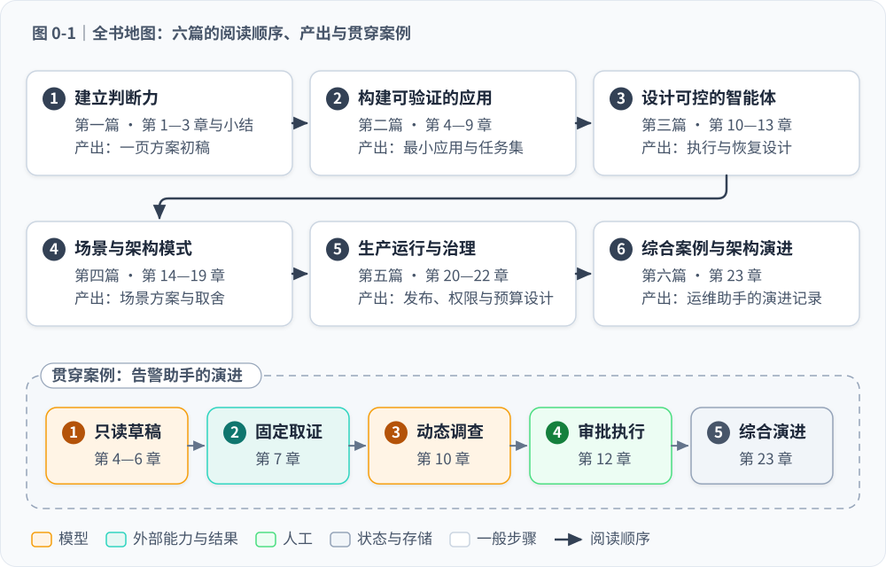

# 阅读路线与全书地图

本卷以“能否独立设计一个新需求”为验收目标。首次阅读建议按篇章顺序推进；已有项目的读者，可以先用第 2 章的标准一页方案识别缺口，再查阅相关章节。

**读图**：图 0-1 上半部分是六篇的阅读顺序与各篇产出，下半部分是贯穿全书的告警助手怎样演进：第 4—6 章只读整理给定材料，第 7 章增加固定取证，第 10 章引入动态调查，第 12 章加入审批后执行，第 23 章汇总为完整的演进记录。

## 各阶段的产出

| 阶段 | 对应章节 | 阶段产出 |
| --- | --- | --- |
| 建立判断力 | 第 1—3 章、第一篇小结 | 一份标准一页方案初稿与一张参考架构草图 |
| 构建可验证应用 | 第 4—9 章 | 最小应用、任务集、输出契约与证据来源 |
| 设计可控智能体 | 第 10—13 章 | 执行与状态设计、失败恢复、人工协作、协作取舍 |
| 迁移到陌生场景 | 第 14—19 章 | 按需求变化推导的架构方案与验收依据 |
| 生产运行与治理 | 第 20—22 章 | 发布检查、线上反馈、权限治理与资源预算 |
| 综合设计 | 第 23 章 | 运维助手的决策记录、演进条件与验证计划 |

第 6 章集中说明评测基础，第 20 章处理发布与持续运行；从第二篇起就可以开始判断应用是否有效。

## 两条推荐路线

- **按顺序阅读**：第一篇建立方法，第二篇做出最小应用，第三篇处理动态行动、状态与人工协作，第四篇在陌生场景中练习，第五、六篇进入生产运行与综合演进。
- **先看场景**：读完第 2、5、6 章后，可以直接阅读第 14、15 章。两章涉及的工具、状态和权限概念，可以回查第 3、7 章。

设计评审时常用的材料集中在两处：[附录 E 设计模板](../appendix/templates/README.md)提供空白的一页方案、评测样例与工具契约，[附录 F 模式速查](../appendix/patterns.md)提供十种常用模式与选择表。


**本书写作状态**：第 1—7、14、15 章与第一篇小结已有正文，其余章节标为“撰写中”。配套示例使用离线响应回放，在线模型的效果、延迟与成本尚未验证。

