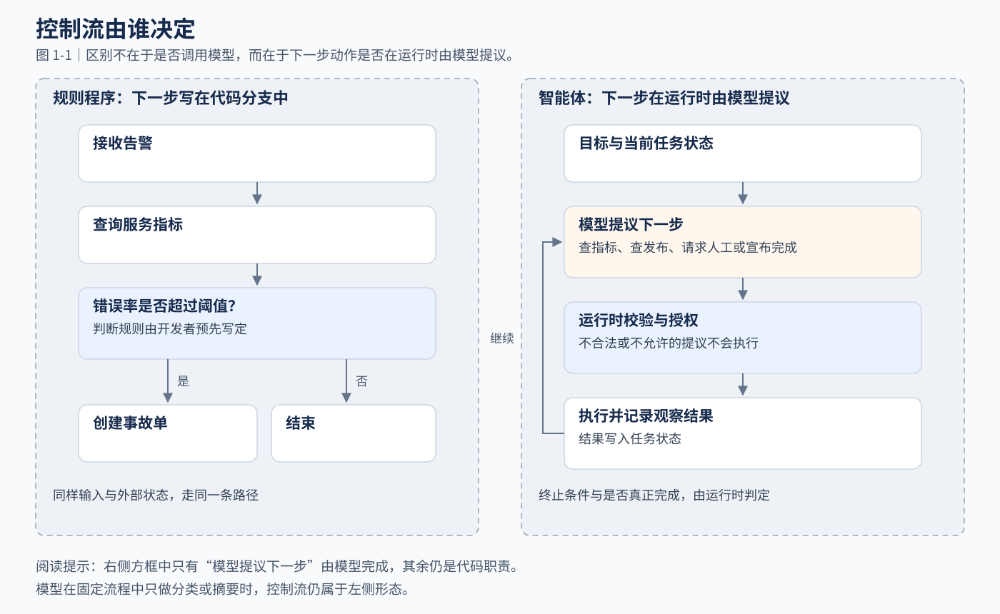
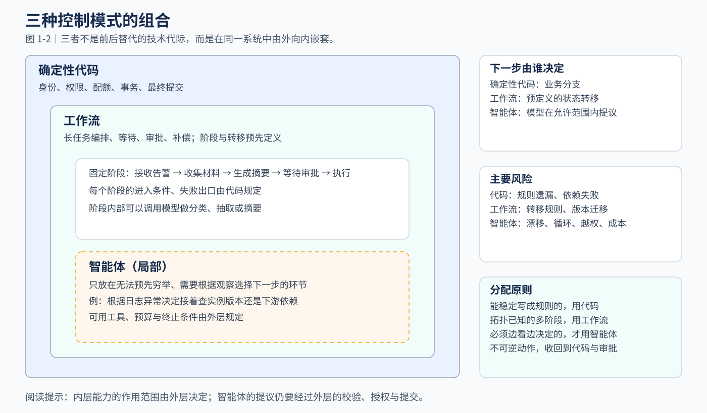
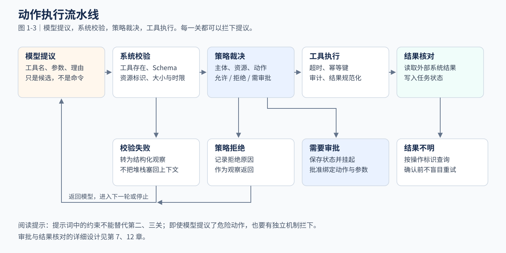

# 第 1 章 AI 应用的软件工程基础

> **已有经验**：模块划分、接口与服务边界。
>
> **新增问题**：生成内容与下一步建议不能自动取得业务控制权。
>
> **本章产出**：一份规则、模型与执行器的职责划分。

在规则驱动的应用中，开发者预先写好业务规则，再用类型、测试、事务和监控保证正确与可靠。引入智能体（Agent）之后，这些机制全部继续有效。新的变化只有一处：**在应用允许的范围内，部分后续动作可以由模型根据目标、上下文和环境反馈在运行时提出，而不必全部由预设分支选定。**

因此，开发智能体应用要回答的核心问题是：

> 系统中有一个能力很强、但输出不能被完全预测的决策组件时，怎样仍然向业务提供可验证、可恢复、可治理的服务承诺？

本章给出回答这个问题的基本方法：先看清控制流在哪里发生变化（1.1），识别两类不确定性（1.2），选择控制模式（1.3），把决策权与执行权分开（1.4），划分代码与模型的边界（1.5），明确运行时的职责（1.6），最后用一个运维案例完整演练（1.7），并列出四个常见反模式（1.8）。

---

## 1.1 变化的不是接口，而是控制流

**要解决的问题**：AI 应用和普通服务到底哪里不同？

先看一个普通告警处理服务的代码节选。相关类型和依赖函数未展开，5% 为教学阈值：

```go
func HandleAlert(ctx context.Context, alert Alert) error {
    metrics, err := queryMetrics(ctx, alert.Service)
    if err != nil {
        return err
    }
    if metrics.ErrorRate > 0.05 {
        return createIncident(ctx, alert, metrics)
    }
    return nil
}
```

程序可能超时，依赖可能失败；但只要输入和外部状态相同，它的决策规则是确定的：错误率超过 5% 就创建事故单，否则结束。

把模型包装成一次远程调用（输入提示，返回文本或 JSON），控制流并没有改变。真正的变化发生在让模型决定“下一步做什么”的时候：

```go
decision := model.Decide(ctx, goal, state, availableTools)
```

`decision` 可能是查询指标、检索变更记录、请求人工确认，也可能是结束任务。下一步路径不再完整写在源代码中，而是在运行时由模型提议。



图 1-1 对比了两种形态。右侧虽然多了模型，但只有“提议下一步”这一格由模型完成；校验、授权、执行和终止判定仍然是代码职责。

### 判断方法：模型是否参与了控制流

检查模型是否在允许范围内承担以下任一职责：

- 选择下一步动作；
- 选择或组合工具；
- 根据观察结果修改计划；
- 判断任务是否已经完成。

都没有的，本书称为**模型增强应用**：模型只在固定流程中做分类、抽取、摘要或生成。承担了其中一项或多项的，进入本书讨论的智能体范畴，第 2 章会进一步细分控制方式。

这是本书的工作定义，用于组织设计讨论，不是行业统一的分类标准。例如，模型分类器在预定义工作流中选择分支，外层的分支和转移仍由代码规定，本书仍把它归为固定流程。

---

## 1.2 两类不确定性：模型与环境

**要解决的问题**：智能体系统的风险从哪里来，分别用什么手段应对？

风险来自两个方向：模型本身的输出不可完全预测，模型所操作的外部环境也在不断变化。两者会叠加。下表列出常见情形和对应的设计手段。

### 模型不确定性

即使使用结构化输出并降低采样随机性，也不能把模型当作普通函数：

| 情形 | 设计应对 | 详见 |
| --- | --- | --- |
| 模型升级、系统提示或上下文顺序变化，决策随之改变 | 记录模型与提示版本，变更后用同一任务集回归评测 | 第 6、20 章 |
| 输出是合法 JSON，但参数在业务语义上错误 | 结构化输出只约束格式；业务校验由应用完成 | 第 4、5 章 |
| 遗漏约束、误解目标、过早宣布完成 | 完成条件由运行时验收，不以模型声明为准 | 第 10 章 |
| 长上下文中的关键信息没有被稳定利用 | 按任务选择和组织材料，而不是一味加长上下文 | 第 8 章 |

### 环境不确定性

| 情形 | 设计应对 | 详见 |
| --- | --- | --- |
| 查询结束后，资源状态已经改变 | 执行前重新核对关键条件 | 第 11 章 |
| 工具超时，动作可能已经执行 | 使用操作标识，先查询结果再决定是否重试 | 第 7、12 章 |
| 两个并发任务同时修改同一对象 | 版本检查等并发控制 | 第 11 章 |
| 检索结果过期、不完整或被恶意内容污染 | 保留来源与版本；把外部内容当作数据，不当作指令 | 第 9、21 章 |

传统程序的恢复路径由工程师预先定义；智能体则可能根据错误信息提出新的行动路径。允许动态行动后，需要考虑的状态与故障情形可能增多，具体范围取决于开放了哪些工具和采用什么控制策略。

所以，运行时的职责不是消除不确定性，而是把它约束在业务可以接受的范围内。

---

## 1.3 三种控制模式，可以组合使用

**要解决的问题**：一个系统中，哪些部分由代码控制，哪些由工作流控制，哪些交给模型？

本书按“下一步由谁决定”区分三种控制模式：

| 模式 | 控制流由谁决定 | 适合的问题 | 主要风险 |
| --- | --- | --- | --- |
| 规则程序 | 业务代码 | 规则明确、参数校验、事务提交 | 规则遗漏、实现缺陷、外部依赖失败 |
| 工作流（Workflow） | 预定义的图或状态机 | 分阶段处理、等待、并发编排与审批 | 转移规则、版本迁移、状态一致性 |
| 智能体循环（Agent Loop） | 模型在运行时选择动作 | 目标明确但路径未知，需要探索和多步归因 | 漂移、循环、越权、成本和不可复现 |

两点说明：工作流不等同于有向无环图（DAG），也可以包含循环；能否持久化、恢复和补偿，取决于具体的工作流实现。



三种模式不是前后淘汰的三代技术，而是在同一系统中由外向内嵌套（图 1-2）：

1. 确定性代码负责身份、权限、配额、事务与最终提交；
2. 工作流负责长任务编排、等待、审批和补偿；
3. 智能体只进入那些无法提前穷举、但可以通过观察和工具逐步求解的局部环节。

因此，设计时要问的不是“要不要用 Agent”，而是：**哪一段控制流值得在运行时交给模型？** 1.5 节给出判断这一点的四个问题。

---

## 1.4 决策权必须与执行权分离

**要解决的问题**：模型提出了一个动作，系统凭什么执行它？

模型擅长提出候选动作，但不应天然拥有执行权。本书把这条边界概括为一句话：

> **模型提议，系统校验，策略裁决，工具执行。**
> （LLM proposes, system validates, policy decides, tool executes.）



图 1-3 中的每一关都能拦下提议。按顺序实现：

**第一关 模型提议。** 模型返回工具名、参数和动作理由。系统把它当作一份不可信的候选，而不是命令。

**第二关 系统校验。** 检查工具是否存在、参数能否通过 Schema、资源标识是否合法、是否超过大小和时间限制。校验失败时，生成结构化的观察结果返回给模型，不把底层堆栈原样塞回上下文。

**第三关 策略裁决。** 判断当前主体能否对这个资源执行这个动作。Schema 合法不等于业务允许：同一个 `restart_workload`，在测试环境可以自动执行，在生产环境可能需要值班人员批准，对某些核心资源则可以按业务规则直接禁止。

**第四关 工具执行。** 执行器负责超时、幂等键、审计、并发限制和结果规范化，返回执行状态与可核对的结果；它不负责制定后续调查计划。工具结果仍可能过期或不完整，所以图中还有最后一步结果核对。

由此得到一条贯穿全书的规则：**提示词不能替代执行权限边界。** 提示中的约束不能单独保证危险操作被阻止，必须有独立的参数校验、权限与隔离机制，并且这些机制本身也要经过验证。

---

## 1.5 划分边界：确定性骨架与概率性岛屿

**要解决的问题**：具体到一个需求，哪些环节写成代码，哪些交给模型？

本书用两个比喻描述划分结果：由代码和工作流组成的**确定性骨架**，承接身份、状态、副作用和恢复；嵌在骨架中、由模型参与决策的局部环节，称为**概率性岛屿**。这是本书用语，不是行业术语。

对需求中的每一个环节，依次回答四个问题：

| 顺序 | 问题 | 回答为“是”时 |
| --- | --- | --- |
| 1 | 规则是否稳定，并且可以枚举？ | 用代码实现 |
| 2 | 路径复杂，但阶段和转移已知？ | 用工作流实现 |
| 3 | 需要在未知环境中根据观察多步探索？ | 评估智能体方案 |
| 4 | 一次错误动作的损失是否难以恢复？ | 收回执行权，或增加人工审批 |

**示例**：

- “查询过去七天订单总额”：规则稳定，第 1 问为“是”，写成确定性查询。
- “解释华东区域退款率异常的可能原因”：需要跨指标、日志和业务事件探索，第 3 问为“是”，可以作为概率性岛屿评估模型方案。
- “根据分析结果直接批量退款”：第 4 问为“是”，执行必须回到确定性的审批和事务系统。

**边界**：本书不规定代码与模型的固定比例，也不存在可以直接计算的“自主权与风险反比公式”；确认点的数量也不能单独代表安全程度。对后果严重的操作，按动作性质选择更严格的权限、执行前校验或人工审批。

---

## 1.6 运行时需要承担的职责

**要解决的问题**：让模型参与控制流之后，代码还需要做什么？

教学演示中的智能体循环可能只有十几行：模型决定动作，工具返回结果，循环直到模型宣布结束。一旦系统需要多步调用或产生外部副作用，就需要一个运行时（Runtime）来持有模型之外的控制权。下面的代码说明职责划分：

> 以下代码为职责示意，省略了状态推进、预算计数与错误处理细节，不能直接作为完整运行时使用。

```go
type RuntimeLimits struct {
    MaxSteps       int
    MaxWallTime    time.Duration
    MaxTokenBudget int
    MaxToolCalls   map[string]int
}

type TaskState struct {
    TaskID        string
    Goal          string
    Status        TaskStatus
    Facts         []Fact
    PendingAction *Action
    Step          int
    Version       int64
}

func (r *Runtime) Run(ctx context.Context, task *TaskState) (*Result, error) {
    for !task.Status.Terminal() {
        if err := r.limits.Check(task); err != nil {
            return r.stop(task, err)
        }

        proposal, err := r.model.Propose(ctx, r.buildContext(task))
        if err != nil {
            return r.retryOrStop(task, err)
        }

        action, err := r.validator.Validate(proposal)
        if err != nil {
            r.observeValidationError(task, err)
            continue
        }

        verdict := r.policy.Decide(ctx, task, action)
        if verdict.RequiresApproval {
            return r.suspendForApproval(task, action)
        }
        if !verdict.Allowed {
            r.observePolicyDenied(task, verdict)
            continue
        }

        observation := r.executor.Execute(ctx, action)
        r.checkpoint.Append(task, action, observation)
    }
    return r.result(task), nil
}
```

对照代码，运行时的六项职责如下：

| 职责 | 为什么需要 | 最小做法 | 详见 |
| --- | --- | --- | --- |
| 预算控制 | 循环次数、耗时、Token 和工具费用都可能失控 | 步数、时间、Token、各工具调用次数分别设上限 | 第 10 章 |
| 循环检测 | 模型可能反复执行相同动作 | 记录动作签名与错误类别，识别重复轨迹 | 第 10 章 |
| 状态持久化 | 进程会退出，任务要能接着做 | 保存检查点与动作状态，并核对外部副作用 | 第 11、12 章 |
| 并发控制 | 多个执行器可能同时推进同一任务 | 原子版本检查；使用租约时处理过期执行器继续操作的问题 | 第 11 章 |
| 人工挂起 | 审批可能要等很久 | 保存必要状态后挂起，不持续占用执行资源 | 第 12 章 |
| 终止权 | 模型可能过早宣布完成，也可能一直不停 | 运行时可以否决模型的“继续”，也可以拒绝过早的“完成” | 第 10 章 |

注意状态持久化的边界：仅保存检查点不能保证外部动作不重复执行，因为检查点写入与外部服务通常不在同一个事务内。第 3 章 3.6 节解释了这个时间差。

循环本身只有几行代码，工程工作量主要落在这六项职责上，这也是本书第三篇的重点。

---

## 1.7 案例演练：支付服务告警

**要解决的问题**：把 1.3—1.6 的方法用在一个完整需求上。

> 支付服务在发布后错误率升高。系统目标：定位原因，并在安全范围内缓解故障。

先看不加约束会怎样：智能体读到告警后立即重启实例，失败后反复重启，最后根据不完整的日志宣布问题已解决。下面用 1.5 节的四个问题逐个环节划分职责。

**第一步：拆出环节。** 接收告警、拉取材料、选择调查方向、判断操作风险、执行回滚、检查恢复、生成摘要。

**第二步：逐个环节回答四个问题。**

| 环节 | 实现方式 | 依据（对应 1.5 节的问题） |
| --- | --- | --- |
| 接收告警、创建任务 | 确定性代码 | 第 1 问：去重和幂等规则可以枚举 |
| 拉取指标、日志、发布记录 | 受控工具 | 查询本身是固定能力，输入输出要可审计 |
| 选择下一项证据、形成根因假设 | 智能体 | 第 3 问：下一步查什么取决于上一步看到什么 |
| 判断操作风险 | 策略引擎 | 1.4 节：不能由模型自我授权 |
| 回滚生产发布 | 工作流加人工审批 | 第 4 问：高风险，需要补偿和留痕 |
| 检查指定窗口内的错误率 | 确定性规则 | 第 1 问：指标条件可以写成规则 |
| 生成事故摘要 | 单次模型调用 | 固定流程中的整理任务，不需要模型选择下一步 |

**第三步：检查边界。** 错误率回落只说明“在指定窗口与口径下观察到指标改善”，不能单独证明根因已消除，也不能证明回滚是改善的原因。是否关闭事故，需要另外的业务规则。

**第四步：确定验证方式。** 评价这个方案时，看模型是否改善了具体任务（例如值班人员定位原因所需的时间和准确性），以及新增的运行成本与风险是否得到控制。第 2 章会把这个案例收缩为一个更小的第一版，第 23 章展示它的完整演进。

---

## 1.8 四个常见反模式

每个反模式按“症状、原因、修正”说明。

### 反模式一：万物皆 Agent

- **症状**：固定查询、字段映射和阈值判断被包装成多个 Agent 互相对话。
- **原因**：这些逻辑本来可以稳定编码，交给模型后增加了调用开销和需要处理的失败情形。
- **修正**：先画确定性流程，再标出真正无法枚举的决策点。智能体是局部能力，不是默认容器。

### 反模式二：把提示词当权限系统

- **症状**：系统提示写着“禁止删除生产资源”，但工具凭证仍然拥有删除权限。
- **原因**：模型受提示注入或上下文污染影响提出删除动作时，系统没有独立的限制可以拦下它。
- **修正**：最小权限凭证、工具白名单、参数策略和审批机制必须位于模型之外（图 1-3 的第二、三关）。

### 反模式三：只有 `max_steps`，没有收敛判定

- **症状**：只限制最多执行 20 步。
- **原因**：步数上限约束不了每步耗时、Token 和工具费用，也阻止不了在 20 步内反复执行相同动作。
- **修正**：预算分项设置；记录动作签名、错误类别和状态增量，连续多步没有产生新事实时主动停止或交给人工。

### 反模式四：把消息历史当任务状态

- **症状**：保存了对话记录，就认为任务可以恢复。
- **原因**：普通对话没有定义并发版本、待审批动作、幂等键和恢复规则。结构化的事件记录可以承载这些信息，但前提是明确了事件语义和状态转换规则。
- **修正**：用结构化的任务状态保存业务事实和执行状态，再按需投影成模型上下文（第 3 章 3.4 节）。

---

## 本章小结

1. 智能体应用的根本变化，是模型获得了部分运行时控制流的提议权；判断方法见 1.1 节的四项职责。
2. 模型不确定性和环境不确定性会叠加，每一类都有对应的设计手段（1.2 节两张表）。
3. 规则程序、工作流与智能体是由外向内嵌套的控制模式，可以组合在同一个系统中。
4. 决策权与执行权分离：模型提议，系统校验，策略裁决，工具执行；提示词不能代替权限和策略。
5. 用四个问题划分确定性骨架与概率性岛屿；运行时承担预算、循环检测、状态、并发、挂起和终止六项职责。

## 资料与适用范围

本章的控制模式划分与第 2 章引用的 Anthropic 工程文章一致，具体依据和核验记录见[第 2、3 章核验记录](../references/ch02-ch03-review.md)。“确定性骨架”“概率性岛屿”、四个划分问题、运行时职责表和支付告警案例，均为本书的设计方法与教学构造，没有对应的实验结论。示意代码仅说明职责划分，不是可运行的实现。

## 迁移练习

服务台希望把维修工单整理成摘要，并自动关闭“看起来已经处理完”的工单。请划分模型和业务系统的职责。先按第 2 章的一页方案组织答案，再阅读参考思路。

### 参考思路

**当前选择**：先用受控生成整理摘要；关闭工单依据明确的完成记录与业务规则，缺少依据时保留待审阅状态。

**需要追问**：完成的权威记录是什么，误关闭的后果是什么，现有关闭流程能否复用？

**暂不采用的方案**：不让模型仅凭语气决定关闭；也不必因整理文本而增加智能体循环。规则模板应作为摘要基线。

**改变选择的条件**：只有在确需动态查询处理记录且有可靠反馈时，才评估局部调查；关闭边界仍独立。
