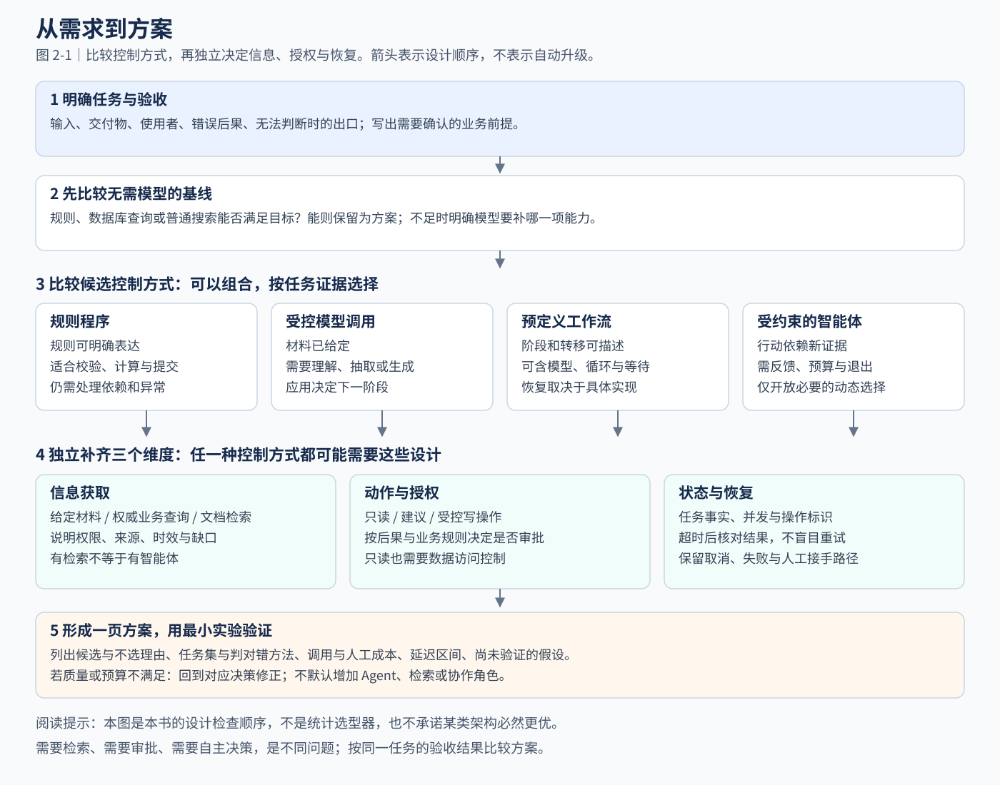

# 第 2 章 从需求到方案：智能体应用的架构决策

> **已有经验**：需求拆解、架构评审与 ADR。
>
> **新增问题**：控制方式、信息获取和动作权限需要分别决定。
>
> **本章产出**：一页方案和可推翻当前选择的验证计划。

“我们想做一个 AI Agent，自动处理线上告警。”

这是一个常见的项目起点，但还不是一份可以直接实施的需求。它指定了技术名称和大致场景，却没有说明要代替哪一部分工作、允许系统做什么，以及怎样判断任务已经完成。

如果立刻开始选择框架，团队很容易把大量精力放在运行时、工具协议和多智能体协作上，最后才发现：值班人员最需要的只是把分散材料整理到一起；或者，真正阻碍自动化的是数据权限与审批流程，模型能力并不是首要问题。

本章讨论如何从业务问题推导架构。我们继续使用运维助手案例，但这里做的是设计分析，不是已经完成的生产项目复盘。读完本章，你应当能够写出一份有边界、有备选方案、有验证方法的架构决策记录。

## 2.1 把技术诉求翻译成业务任务

“自动处理告警”至少可能包含五类工作：接收并去重告警、收集材料、解释现象、提出处置建议，以及执行操作并验证恢复。它们需要的信息、承担的风险和适合的实现方式并不相同。

因此，需求讨论应先把任务拆开，而不是把整条流程交给一个宽泛的目标。

| 工作环节 | 预期交付物 | 需要进一步确认的问题 |
| --- | --- | --- |
| 接收与去重 | 一条可追踪的调查任务 | 哪些告警属于同一事件，如何处理重复通知？ |
| 材料收集 | 带来源与时间的证据包 | 数据在哪里，调用者是否有权访问？ |
| 现象解释 | 事实、假设与信息缺口 | 结论需要达到什么可信程度，由谁审阅？ |
| 处置建议 | 候选动作与适用条件 | 有无既有操作手册，哪些建议需要审批？ |
| 执行与验证 | 操作记录及结果判定 | 如何授权、避免重复执行，以及确认状态变化？ |

这张表不意味着每个环节都需要独立服务。它帮助团队先区分责任，再选择实现。

### 明确使用者与使用时点

同样一份分析，在不同工作阶段有不同用途。故障调查初期，值班人员需要快速了解已知事实与信息缺口；事故复盘阶段，则需要完整时间线和经过确认的原因。前者可以包含明确标注的假设，后者不能把未经验证的猜测当作最终结论。

对于本书的第一版应用，我们选择较小的任务：在告警出现后，把调用方已经提供的材料整理成一份可审阅草稿。用户仍负责调查和处置，系统不自动关闭告警。

这样得到的需求描述可以写成：

> 当值班人员提供一条告警及相关证据时，系统整理主要现象、证据支持的调查假设和待确认事项；每项发现能够回到输入材料，信息不足时明确说明。输出用于辅助人工调查，不作为自动执行操作的依据。

这段话包含触发条件、输入、交付物与使用边界。它没有预先要求使用智能体，因为目前尚未证明需要模型自主选择下一步。

### 区分事实、假设与约束

需求文档里的每一句话并不具有相同的证据地位。

“现有告警平台能够提供服务标识”可以通过接口检查确认。“模型整理材料能够缩短调查时间”则是待验证的产品假设。“第一版不执行生产写操作”是团队对范围的约定。

如果把三者混在一起，后续设计就容易建立在未经验证的前提上。建议为关键前提留下来源或状态：已经确认、尚待验证、由项目约定。这里的状态用于管理决策依据，不是给业务事实随意添加可信度分数。

## 2.2 把成功标准写在方案之前

没有成功标准，架构比较就会退化成技术偏好。一个复杂方案看起来能力更多，却未必改善用户的工作。

先定义交付物是否合格，再定义引入它是否值得。

对告警草稿，交付物标准包括数值不被篡改、观察与假设分开、引用与材料对应、信息缺口清楚。业务价值则要通过使用过程判断：值班人员是否更快找到关键材料，是否减少重复整理，是否增加了纠正错误的负担。

两类标准应分别记录。模型即使生成了结构合格的报告，也可能只是把原始材料改写一遍，没有减少用户工作量。

### 定义指标的对象与分母

“准确率达到 95%”并不是充分的验收描述。它没有说明被判断的对象是字段、句子、整份报告还是完整任务，也没有说明超时与拒答是否计入。

更明确的定义例如：

> 在满足输入约定并进入评测的任务中，报告通过预先定义的事实、引用和信息缺口检查，并能供值班人员继续调查，记为一次任务通过。调用失败也保留在任务记录中，不因没有产生报告而从分母中消失。

这是一种适合本案例的指标定义，不是所有 AI 应用必须采用的统一标准。若还需要分析格式质量，可以另外计算生成结果的契约通过率，但应写清它与任务通过率的区别。

同样，衡量耗时时需要明确起止点。模型完成生成的时间，与用户取得一份经过审阅的报告所需时间，回答的是不同问题。前者适合定位技术瓶颈，后者更接近实际使用价值。

### 分开评估不同错误

漏掉一条辅助日志、把错误比例写错一个数量级、向无权限用户展示敏感材料，不能用相同的权重草率相加。

项目可以根据后果制定不同规则：一般表达问题允许人工修订；关键事实错误会使报告不通过；权限越界则触发单独的阻断与调查流程。具体分类由业务确定，不能仅由模型打分代替。

也不应把少量样例中的零次失败解释为风险已经消失。观察结果只说明在给定样例、版本和条件下发生了什么，不能替代对未覆盖场景的分析。

### 保留一个无需模型的基线

在运维案例中，可以先用固定模板展示指标、发布记录和日志摘要。它不能提出复杂假设，但仍可能解决“材料分散”的主要痛点。

比较模型方案与这个基线，可以回答一个实际问题：生成能力带来的整理与分析收益，是否足以抵消调用资源、等待时间和人工校核成本？在获得数据前，这应当是一项实验目标，而不是需求文档中已经成立的结论。

## 2.3 选择控制方式，而不只选择技术名称

为了讨论清楚，本书按控制职责区分规则程序、模型调用、预定义工作流与智能体。它们不是互斥的产品分类，也不是依次升级的技术等级。

Anthropic 的工程文章区分了由预定义代码路径组织的工作流，以及由模型动态决定过程与工具使用的智能体。本书借用其中“由谁决定下一步”的视角，但不将其视为全行业唯一的术语定义。[Building effective agents](https://www.anthropic.com/engineering/building-effective-agents)

### 规则程序：用已知规则处理问题

如果任务可以用稳定规则表达，规则程序通常值得作为首个候选。告警去重、按权限过滤资源和检查必填字段，都可以先从明确的业务规则出发。

这里的“规则明确”不表示程序不会失败。网络、并发、实现缺陷和外部数据变化仍然可能影响结果。它表示业务判断的规则已经由开发者表达，系统不需要让模型临时决定如何解释这条规则。

### 模型调用：在受控位置完成理解与生成

如果输入已经给定，只需完成分类、抽取、摘要或受约束的内容生成，可以把模型放进一个普通应用流程。流程仍由业务代码控制，模型只承担其中一个步骤。

告警草稿属于这个候选：材料已经装配好，模型整理后返回，应用检查并交给人阅读。即使服务端内部执行了复杂计算，也不意味着应用已经把下一步业务行动交给智能体。

“单次调用”描述的是初始流程设计，不是任何时候都只能发生一次网络请求。有限的网络重试或明确规定的格式修正，不必因此被命名为智能体。

### 工作流：预先定义允许的状态与转移

如果任务包含多个阶段，而且阶段关系、路由规则和等待条件可以预先表达，就可以使用工作流。比如收集材料、生成报告、等待人工确认，再提交到事故记录系统。

工作流并不等于有向无环图（DAG）。DAG 适合表达没有环的依赖关系；工作流也可以通过状态机表达循环、重试、等待和恢复。工作流是否持久化，则取决于具体实现与存储机制，不能从名字推断。

工作流可以包含模型分类器。即使模型负责在几个类别之间选择，外层允许的分支和转移规则仍可由代码预定义。是否称为智能体并不影响系统必须说明这些边界。

### 智能体：在允许范围内动态选择下一步

当任务需要根据新证据反复决定查询什么、检查什么，以及是否继续调查时，可以评估智能体方案。

例如，只有看到日志中的某类异常后，才知道应进一步比较实例版本还是查询下游依赖。模型可以提出下一项调查动作，系统仍需要限制可用工具、参数范围、预算和终止条件。

路径不易预先确定只是引入智能体的一个理由，还不是充分条件。如果环境无法提供可靠反馈，或错误行动无法被约束，那么把路径选择交给模型并不能自动使任务可行。

### 用比较表记录选择依据

| 当前主要问题 | 首先评估的方案 | 需要验证的条件 |
| --- | --- | --- |
| 规则与数据结构明确 | 规则程序 | 规则是否覆盖真实输入，异常能否被清楚处理？ |
| 需要整理给定的非结构化材料 | 受控模型调用 | 材料是否充分，输出能否被验证？ |
| 多步骤但阶段关系可定义 | 工作流 | 分支、等待、恢复和状态归属是否明确？ |
| 后续行动依赖新证据，需要动态调查 | 受约束的智能体 | 工具反馈、进展判断、终止与接管是否成立？ |

这是一份本书用于组织设计讨论的比较表，不是经过统计验证的选型评分器。一个系统可以在不同环节采用不同方案。

## 2.4 一页方案：把判断写成可检查的清单

下面的清单是全书共用的设计产物。每格写结论、依据与未决事项；“待验证”必须附实验，不能只是留空。它用于准备讨论，不代表方案已经可以上线。

| 决策项 | 必须回答的问题 | 本书告警草稿的第一版选择 |
| --- | --- | --- |
| 任务与价值 | 谁在什么时点需要什么交付物？ | 值班人员需要有证据引用的待审阅草稿 |
| 无模型基线 | 规则、查询、搜索或模板能做到什么？ | 固定模板已能集中展示材料，先与它比较 |
| 模型职责 | 哪一部分值得引入理解或生成？ | 整理现象、假设与信息缺口 |
| 控制方式 | 单次生成、工作流还是动态行动？ | 固定流程中的受控生成，暂不自主查询 |
| 信息获取 | 直接材料、业务 API 还是文档检索？ | 调用方提供证据；没有知识缺口证据前不加检索 |
| 数据处理 | 哪些数据敏感，在哪里处理，是否传给第三方？ | 教学材料先脱敏；真实接入前核对处理位置、留存与用途 |
| 动作与授权 | 会改变什么状态，是否需审批？ | 只生成草稿；数据权限仍由接入层保证 |
| 状态与失败 | 保存什么，超时与取消如何结束？ | 返回明确失败状态，不将半份报告当成完成 |
| 评测验收 | 哪些能自动检查，哪些需人工判定？ | 检查结构与引用，人工判断事实和调查价值 |
| 成本与延迟 | 按什么假设估算，怎样实测？ | 记录输入输出规模、一次生成、人工审阅与失败调用 |
| 最小实验 | 什么结果会改变当前选择？ | 若主要缺口是取证，再评估固定查询与动态调查 |

为了便于复制，作者在[一页方案模板](../templates/one-page-design.md)中保留了空白字段。场景篇和章末练习采用相同顺序，而不是每到一个行业就换一套方法。



图 2-1 先比较基线和控制方式，再分别决定信息获取、授权与恢复。它不是“需求复杂就用 Agent”的自动评分器。图中的选项可以组合，也允许实验后回到前面的决策；[SVG 构建源文件](../assets/build-decision-map.py)随书维护。

例如，合同问答需要检索，不代表需要自主行动；固定审批流需要人工确认，不代表必须使用模型；只根据当前证据动态选择分析步骤的智能体，也不一定需要另建知识库。

## 2.5 在架构图上标明数据与动作边界

只画“用户—模型—工具”三个方框，无法说明系统如何承担责任。至少还应明确：数据来自哪里，谁有权读取，哪些状态由应用维护，以及什么条件下允许改变外部世界。

对第一版告警助手，可以形成下面的职责表：

| 对象或行为 | 本阶段的责任归属 | 边界说明 |
| --- | --- | --- |
| 告警与证据包 | 调用方提供，应用校验 | 模型不能凭空补齐缺失材料 |
| 材料访问权限 | 接入系统与应用身份层 | 引用一个 ID 不代表已获得读取授权 |
| 事实整理与调查假设 | 模型生成候选内容 | 应用校验结构，内容仍需评审 |
| 报告状态 | 应用设置 | 模型不能自行把故障标记为已解决 |
| 操作执行 | 第一版不提供 | 后续接入时单独设计授权、恢复与审计 |

这张表是设计目标。第 5 章的本地示例使用人工提供的教学文件，只实现其中的输入与报告处理，并没有实现真实身份系统或生产数据接入。

### 数据去向必须成为方案的一部分

将输入、检索结果、模型请求、运行日志和人工审阅材料画成数据流，分别说明处理位置、第三方接收者、保留期限和删除责任。不能因为某个服务可调用，就默认所有业务数据都可传入。处理条件尚未确认时，可以先用合成或经核验的脱敏数据验证流程；真实数据准入仍是独立的决策。

信息不足时应选择补问、拒答或交给有责任的人处理，不能用模型自报的高置信度替代证据。涉及招聘、授信等对个人权益有重要影响的任务，还要单独设计复核、申诉及错误分布检查；具体法律适用见[附录 D](../appendix/compliance-cn.md)。评测所需数据也应有明确用途和访问边界，不为分析方便额外收集无关敏感信息。

### 只读不等于没有风险

读取日志不修改业务资源，但仍可能涉及敏感内容、跨租户数据或昂贵查询。因此，读写划分适合判断副作用，却不足以涵盖全部风险。

设计时还需要考虑数据敏感程度、可访问范围、调用资源消耗，以及结果会被谁看到。对读操作实施范围限制，与对写操作实施审批，是两个可以同时存在的控制措施。

### 将假设与事实分开存放

“模型怀疑发布有问题”是一项调查假设。“发布平台记录 09:58 完成版本更新”是一条带来源的材料。“系统已经回滚到上一版本”则需要执行结果支持。

如果把三者写入同一个没有类型区分的摘要字段，后续组件就容易把推测当作事实继续使用。初期不一定需要复杂数据库，但需要保留它们的语义差别。第 3 章将进一步区分上下文、记忆和任务状态。

## 2.6 在引入自主行动前验证反馈与退出机制

智能体需要根据行动结果调整后续步骤。若工具只返回一段含糊的“处理成功”，模型与应用都难以判断任务是否有进展。

在告警调查中，查询结果可以提供时间范围、命中记录、统计口径与数据缺失情况。这些信息有助于判断一次查询是否新增了证据。相反，一段缺少来源的总结，可能让调查循环围绕相同猜测反复运行。

### 定义成功、失败与无法判断

对于报告生成，成功可以定义为产生符合约定的草稿。对于故障处置，成功需要根据业务状态核验，不能沿用“模型已经给出答案”的标准。

即使监控显示错误率回落，也只直接支持“在指定窗口与口径下观察到指标改善”。它是否足以关闭事故、是否与刚才的操作存在因果关系，需要额外依据或业务规则。不要把一个可计算指标承担的责任无限扩大。

退出条件也不应只有“成功”。材料不足、权限不足、预算耗尽、外部服务不可用和人工取消，都可能是合理的结束路径。每一种路径都应保留当前材料并告知接手者，而不是要求模型继续尝试直到编出一个答案。

### 为失败结果不明的操作预留位置

后续如果允许创建工单或执行运维动作，就必须考虑：请求超时后，动作可能已经完成，只是响应没有到达。

因此，“没有收到成功响应”不能直接解释为“没有产生副作用”。安全重试需要依赖具体接口的幂等约定、操作标识和结果核对；AWS 的工程文章给出了这类设计的动机与边界。[Making retries safe with idempotent APIs](https://aws.amazon.com/builders-library/making-retries-safe-with-idempotent-APIs/)

本章不展开实现细节，但架构选择时就需要知道这些问题由谁解决。若团队尚不能判断重复操作的后果，可以先停留在只生成建议、由既有流程执行的范围内。

## 2.7 估算资源预算，说明假设与测量边界

初步设计时不一定知道精确成本，但应当能解释成本由什么构成。按所选服务的实际计费项估算模型输入、输出、缓存或其他收费项目，再加入检索、工具、存储与运行开销；人工审阅与运维成本单独列出，不把它们混成一个看似精确的 API 价格。

```text
单任务资源费用 ≈ 各次模型调用费用之和 + 检索和工具费用 + 可归属的运行费用
成功任务平均资源费用 = 本批任务的总资源费用 / 本批经判定成功的任务数
```

第二个式子的分子包含失败任务消耗；成功数为零时不能给出该平均值。是否将人工费用计入，应在统计口径中注明。公式没有假设所有服务只按 Token 收费，实际项目要按其价格与计量规则展开。

延迟需要画出执行依赖。串行环节可以按同一场景估算耗时相加；可并行的阶段应看关键路径，并计入排队、调度与汇合开销。不能把不同服务各自的 P95 相加就宣称得到端到端 P95，尾部延迟应对完整链路测量。

以下只是教学算例：假定一次请求有两个各 2 秒的模型调用，以及一次 0.5 秒的数据查询，不含排队。全部串行约 4.5 秒；如果两个模型调用没有数据依赖，并在查询完成后并行，理想情况下约 2.5 秒。实际结果还需测量并行资源争用与调度开销，这些数值不是模型性能承诺。

方案应分别给出常规路径、允许的重试路径和预算耗尽时的行为。动态智能体若没有步数、每步资源和总时限约束，就不能仅按一次调用价格估算任务成本。前期使用区间与明确假设，原型完成后用样例替换假设；不要把未知费用写成零。

## 2.8 识别不值得引入模型的职责

反例应针对具体职责，而不是给整个行业贴上“不能用 AI”的标签。同一产品可以将理解交给模型，将计算和执行留在确定性系统。

| 需求或职责 | 优先候选 | 为什么不直接由模型完成 | 何时可以局部引入模型 |
| --- | --- | --- | --- |
| 按明确公式计算金额、税额或库存 | 已验证的计算与业务规则 | 生成数值不能替代精确计算和审计 | 将自然语言转换成待校验的查询或参数 |
| 根据角色判定能否访问订单 | 权限策略与资源归属校验 | 模型不能因为用户解释充分就自行授权 | 帮助用户理解拒绝原因，但不改授权结果 |
| 固定字段映射、告警阈值、定时导出 | 普通代码或工作流 | 额外生成不能直接证明有增量价值 | 输入确有难以规则化的文本整理需求时 |
| 查询当前订单状态或账户余额 | 权威业务接口 | 模型参数中的历史知识不是实时账本 | 理解用户问题后调用接口并解释结果 |
| 材料缺失且没有合法获取渠道的诊断 | 补齐数据或人工调查 | 模型不能凭调用次数补出业务事实 | 生成待调查清单，并明确无法确认结论 |
| 未明确目标、错误后果与验收的自动执行 | 先澄清需求并建立受控试验 | 无法决定哪些行为可接受，也无法证明收益 | 定义边界、反馈与退出条件后再评估 |

不选模型也不是永久结论。如果输入结构、人工成本或能力需求变化，应重评备选方案；变化的依据写进决策记录，而不是凭技术热度切换架构。

## 2.9 用架构决策记录保留推理依据

架构图告诉后来者系统由哪些部分组成，决策记录解释为什么这样组合。后者在 AI 应用中特别有用，因为模型、提示、输入分布和业务要求都可能发生变化。

架构决策记录（Architecture Decision Record，ADR）通常包含背景、决策、状态与后果。Michael Nygard 的原始文章说明了这种轻量记录方式；本书在此基础上补充验证计划与重新评估条件，方便跟踪尚未确认的假设。[Documenting Architecture Decisions](https://cognitect.com/blog/2011/11/15/documenting-architecture-decisions)

下面是一份针对本书案例的设计记录示例。状态为“拟采用”，不是已经取得线上效果的报告。

### ADR-001：先构建只读告警草稿应用

**状态**：拟采用，完成应用边界验证与真实模型评测后再决定是否试用。

**背景**：教学场景中，输入包含告警、指标、发布记录与日志摘要。当前目标是辅助人工整理证据；自动处置的权限、反馈和恢复机制尚未建立。

**备选方案**：固定模板展示材料；固定流程调用模型整理草稿；由智能体主动查询并调查。

**决策**：保留固定模板作为比较基线，先实现“输入校验—模型整理—结果校验—人工审阅”的流程。第一版不提供生产写操作，也不让模型自行扩展查询范围。

**理由**：当前任务的输入和交付物能够明确描述，尚无证据表明动态选择工具能够带来足够的增量价值。先缩小范围，有利于定位事实错误和材料缺口。

**代价**：应用无法主动补齐证据；分析质量依赖输入材料；真实模型生成仍需要语义评测与人工审阅。固定流程也不能保证每份报告内容正确。

**验证计划**：先用本地保存响应检查输入、引用和失败处理，再用真实模型测试正常、缺失、冲突和误导性材料。对照固定模板评价任务通过情况、人工修订与耗时。

**重新评估条件**：如果试用表明主要瓶颈是材料缺失，先评估增加固定查询步骤；若查询路径确实依赖中间证据，再设计受约束的动态调查。是否增加自主性由对照结果决定。

**尚未确定事项**：在线模型、具体服务预算、数据接入权限和上线阈值。未确定之前，不把方案标记为可上线。

这份记录没有复杂的评分，但使每个关键取舍都可以被追问。当条件变化时，团队可以更新状态或新增替代决策，而不是抹去原来的背景。

## 2.10 把架构结论变成下一步实验

架构讨论的结束点，不应只是“我们决定使用某框架”，而应是一份可以实施的验证计划。

对本书案例，下一步可以分为三项交付：定义证据包与报告契约，实现最小处理流程，以及准备能区分有效整理和错误推断的样例。第 4、5 章建立最小实现，第 6 章系统说明评测集与判对错方法。

在进入实现前，可以用四个问题检查设计是否足够清楚：

1. 如果暂时不用模型，业务还有哪种可行做法？
2. 模型失败或无法判断时，用户会得到什么？
3. 哪些性质能由代码验证，哪些只能通过内容评审与实验评价？
4. 哪个结果会让我们放弃当前方案，或者推迟增加复杂度？

如果第四个问题没有答案，方案可能还只是技术愿望。一个可以被证据推翻的设计假设，才有机会通过实验得到改进。

## 本章小结

从业务问题到架构选择，需要逐步明确任务、成功标准、控制方式、数据与动作边界，以及验证和退出路径。规则程序、模型调用、工作流与智能体各自承担不同的控制职责，可以组合使用。

本章的比较表与 ADR 是设计工具，不是普遍有效的评分公式。它们的价值在于让前提、选择和待验证事项可见，使架构能够随着证据更新。

## 资料与适用范围

文中官方工程资料与 ADR 原文于 2026 年 10 月 9 日核对。引用用于支持相应概念与机制，不能替代具体项目验证。案例、比较表和 ADR 内容为本书的教学设计，未提供真实业务效果或架构收益的实验结论。

## 迁移练习

实验室希望研究人员说一句话就能借用仪器、查使用规程并预约时段。按一页方案写出初步架构。先按第 2 章的一页方案组织答案，再阅读参考思路。

### 参考思路

**当前选择**：先拆分规程问答、可用时段查询与预约提交。问答按适用文档取证，时段由权威接口查询，预约走现有规则与冲突检查；模型用于理解自然语言。

**需要追问**：是否已有结构化目录和预约接口，谁有仪器使用资格，是否涉及培训确认和人工批准？

**暂不采用的方案**：不把实时可用时段放在文档问答里猜测；阶段明确时不采用自由规划；目录很小时表单可能更合适。

**改变选择的条件**：如果需求变为故障诊断且下一步检测依赖反馈，可增加受限调查；新增审批本身不要求 Agent。
