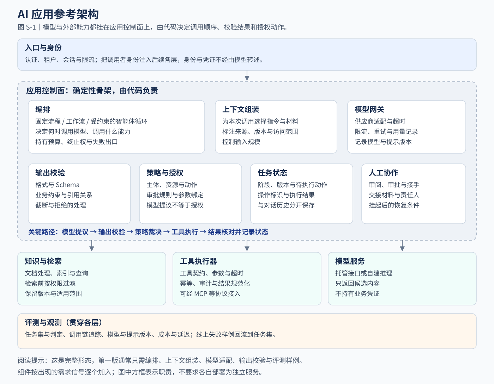

# 设计速查：参考架构、常用模式与构思流程

> **用途**：拿到一个 AI 应用需求时，在一次评审会的时间内给出第一版架构草图。
>
> **前置阅读**：第 1—3 章。本篇把其中的原则整理成可以直接套用的工具，不再重复论证。
>
> **本篇产出**：一张标出组件取舍的架构草图、一组选定的模式，以及一页方案初稿。

后端架构师拿到需求能很快给出方案，依靠的是三样积累：一张熟悉的参考架构（接入层、服务层、存储、消息、监控），一组常用模式（分层、管道、扇出汇合、状态机、Saga），以及一套固定的提问顺序。AI 应用同样可以这样准备。本篇提供这三样东西：

1. **参考架构**：AI 应用由哪些组件构成，各自负责什么，第一版可以省略什么。
2. **模式库**：十种常用的控制与组合模式，每种给出结构、适用信号、主要风险和对应章节。
3. **构思流程**：八步提问顺序，以及一个从陌生需求推到一页方案的完整演示。

建议第一次通读，之后在做设计时把 S.3 的八步流程和 S.5 的速查卡放在手边。

## S.1 参考架构



图 S-1 把 AI 应用分为四部分：入口与身份、应用控制面、能力接入、评测与观测。核心只有一句话：**模型和外部能力都挂在应用控制面上，由代码决定调用顺序、校验结果和授权动作。** 第 1 章的“模型提议，系统校验，策略裁决，工具执行”，就是控制面内部的关键路径。图的构建源文件见 [build-reference-architecture.py](../assets/build-reference-architecture.py)。

### 组件职责与后端对应

| 组件 | 职责 | 对应的后端经验 | 需要补充的新问题 |
| --- | --- | --- | --- |
| 入口与身份 | 认证、租户、会话、限流 | API 网关、认证中间件 | 身份由系统注入下游，不写进提示由模型转述 |
| 编排 | 决定步骤顺序、何时调用模型、何时停止 | 应用服务层、工作流引擎 | 采用智能体循环时，部分顺序由模型提议，编排层要判断进展并持有终止权 |
| 上下文组装 | 为本次调用选择指令、材料和工具说明 | 查询聚合、DTO 组装 | 材料要带来源与版本；放进上下文不代表模型会正确使用 |
| 模型网关 | 供应商适配、超时、限流、重试、用量与版本记录 | RPC 客户端、出口网关 | 拿到响应只说明调用成功，内容还要校验 |
| 输出校验 | 格式、业务约束、引用关系、截断与拒绝 | 入参校验、反序列化 | 能检查结构与可枚举约束，语义正确性交给评测与人工审阅 |
| 策略与授权 | 主体能否对资源执行动作，是否需要审批 | RBAC、ABAC、审批流 | 提议者变成了模型，参数按不可信输入重新校验 |
| 任务状态 | 阶段、版本、待执行动作、操作标识、执行结果 | 业务表、状态机 | 与对话历史分开保存，见第 3 章 |
| 人工协作 | 审阅、审批、接手与交接 | 工单与审批系统 | 审批绑定具体动作与参数版本 |
| 知识与检索 | 文档处理、索引、按权限查询 | 搜索服务 | 检索到的材料还要判断是否适用 |
| 工具执行器 | 工具契约、参数、超时、幂等、审计、结果规范化 | 外部服务适配器 | 调用由模型提议，工具描述本身也是模型的输入 |
| 模型服务 | 生成候选内容 | 外部依赖 | 输出具有概率性，版本变化可能改变行为 |
| 评测与观测 | 任务集、判定、调用链追踪、成本与延迟 | 测试、监控、日志 | 单元测试验证程序逻辑，评测验证任务质量，两者互不替代 |

图中的方框表示职责，不是部署单元。第一版里，编排、上下文组装和输出校验通常只是同一个服务中的几个函数。

### 第一版只取其中一部分

参考架构是完整形态。第一版按需求取用，其余组件在出现明确信号时再加入：

| 组件 | 第一版的最小做法 | 出现什么信号时加强 |
| --- | --- | --- |
| 编排 | 普通函数中的固定流程 | 阶段需要等待、恢复或审批时改用工作流（第 12 章）；下一步依赖新证据时评估智能体循环（第 10 章） |
| 上下文组装 | 一个拼装函数，材料带稳定 ID | 材料超出预算或多轮对话出现信息漂移（第 8 章） |
| 模型网关 | 一个实现模型接口的适配器（第 4 章） | 接入多个模型或供应商，需要统一限流与用量统计（第 22 章） |
| 输出校验 | Schema 加业务校验函数（第 5 章） | 始终需要 |
| 策略与授权 | 只读，复用现有权限系统 | 出现写操作或敏感数据（第 7、21 章） |
| 任务状态 | 无状态请求 | 多步、可中断或有副作用（第 11 章） |
| 人工协作 | 结果标记为待审阅草稿 | 业务要求审批，或需要人工接手（第 12 章） |
| 知识与检索 | 不建，由调用方提供材料 | 评测显示主要缺口是文档知识（第 9 章） |
| 工具执行器 | 不建，或加入固定查询步骤 | 需要实时数据或执行动作（第 7 章） |
| 评测与观测 | 一组覆盖正常、缺失、冲突材料的样例，逐条记录（第 6 章） | 准备发布和上线运行（第 20 章） |

第 5 章的告警助手就是这样的第一版：固定流程、上下文组装、模型适配器、输出校验和评测样例，其余组件暂时留空。

### 工具接入协议：MCP 在架构中的位置

Model Context Protocol（MCP）是一项开放协议，规定 AI 应用与提供上下文和能力的服务器之间如何通信。协议基于 JSON-RPC 2.0 消息，参与方分为主机（发起连接的 AI 应用）、客户端（主机中的连接器）和服务器（提供能力的服务）。服务器可以提供三类能力：资源（供用户或模型使用的数据）、提示模板，以及供模型调用的工具。[MCP 规范](https://modelcontextprotocol.io/specification/latest)

在参考架构中，MCP 属于工具执行器和知识接入的连接方式：它统一了能力的发现和调用格式，让同一个工具服务器可以被多个应用复用。它不改变其他组件的职责。规范明确说明，协议本身无法在协议层强制执行用户同意、数据隐私和工具安全等原则，要求实现者在应用中建立授权流程和访问控制；规范还要求，除非来自可信服务器，工具行为的描述应视为不可信。

因此设计时按以下方式处理通过 MCP 接入的工具：

- 工具调用照常经过输出校验、策略与授权，审批规则不因接入方式改变。
- 工具描述和返回内容按外部输入处理，不能扩大调用者原有的权限。
- 写操作的幂等、结果核对与审计，仍按[工具契约模板](../templates/tool-contract.md)逐项确认。

## S.2 模式库

本节的模式 2—7 采用 Anthropic 工程文章 [Building effective agents](https://www.anthropic.com/engineering/building-effective-agents) 中的名称与定义。该文章说明，这些模式不是规定性的方案，可以按用途组合和调整；只有在能证明改善结果时才增加复杂度。模式 1、8、9、10 以及每个模式的后端对应、风险与控制要点，是本书为设计讨论整理的内容。

每个模式按同一结构说明：结构示意、适用信号、后端对应、主要风险、控制要点、详见章节。

### 模式 1 单次受控调用

```text
输入 → 输入校验 → 上下文组装 → 模型 → 输出校验 → 结果 / 明确的失败状态
```

- **适用信号**：材料已经给定，只需完成分类、抽取、摘要、改写或受约束的生成。
- **后端对应**：调用一个外部服务的普通业务函数。
- **主要风险**：输出格式合法但内容错误；材料不足时编造内容。
- **控制要点**：输出校验；把“材料不足”设计成合法返回值；记录模型与提示版本。
- **详见**：第 4、5 章。

这是首选的起点。Anthropic 的文章指出，对许多应用而言，优化单次模型调用（配合检索和上下文示例）通常已经足够。

### 模式 2 提示链（Prompt chaining）

```text
步骤 A（模型）→ 关口检查（代码）→ 步骤 B（模型）→ 关口检查（代码）→ 结果
                     ↓ 不通过
                 失败或人工处理
```

- **定义**：把任务拆成一串固定步骤，每次模型调用处理上一步的输出；可以在任何中间步骤加入程序化检查（关口）。
- **适用信号**：任务能干净地拆成固定子任务，每一步因此变得更简单。这种模式用更高的延迟换取更高的准确性。
- **后端对应**：管道与过滤器。
- **主要风险**：前一步的错误传递到后续步骤；中间结果的格式不匹配。
- **控制要点**：每个关口用代码检查格式和业务约束；保存中间结果，便于定位是哪一步出错。
- **详见**：第 5、7 章。

### 模式 3 路由（Routing）

```text
输入 → 分类（模型或传统分类器）→ 处理链路 A / 处理链路 B / 处理链路 C / 无法分类出口
```

- **定义**：对输入分类，再交给专门的后续处理。不同链路可以使用不同的流程、提示、工具或模型。
- **适用信号**：输入有几类明显不同、分开处理效果更好的类型，并且分类本身可以做得准确。
- **后端对应**：请求分发、策略模式。
- **主要风险**：误分类把请求送进错误链路，例如把业务办理请求当成知识问答。
- **控制要点**：设置“无法分类”出口；用各类真实样例单独评测分类；界面上已经能让用户选择入口时，不必用模型分类。
- **详见**：第 14 章。

### 模式 4 并行（Parallelization）

```text
         ┌→ 调用 1 ┐
输入 ────┼→ 调用 2 ┼→ 程序汇总 → 结果
         └→ 调用 3 ┘
```

- **定义**：多个模型调用同时处理任务，由程序汇总输出。分为两种变体：分段，把任务拆成独立子任务并行执行；投票，多次运行同一任务以获得多样的输出。
- **适用信号**：子任务相互独立，并行可以缩短耗时；或者任务需要从多个方面分别检查。
- **后端对应**：扇出与汇合（scatter-gather）。
- **主要风险**：部分调用失败时的汇总规则不清；投票的多次调用使用相同材料，结果一致不能视为多份独立证据（第 3 章）；调用成本成倍增加。
- **控制要点**：写明部分失败时是否允许汇总；按关键路径估算延迟，不把各调用的耗时简单相加（第 2 章）。
- **详见**：第 2、3、22 章。

### 模式 5 编排者-执行者（Orchestrator-workers）

```text
输入 → 编排者（模型）动态拆分 → 执行者 1..n（模型）→ 编排者汇总 → 结果
```

- **定义**：一个中心模型动态拆分任务，委派给执行者模型，再综合它们的结果。与并行模式的区别在于，子任务不是预先定义的，而是由编排者根据具体输入决定。
- **适用信号**：无法预知需要哪些子任务，例如一次代码修改要改动多少个文件，取决于具体任务。
- **后端对应**：主从调度，但任务拆分由模型完成。
- **主要风险**：拆分遗漏或重复；子任务数量和成本难以预估；汇总时丢失结论来源。
- **控制要点**：限制子任务数量和总预算；每个子任务的结果带来源；汇总结论回到证据核对。
- **详见**：第 13 章。

### 模式 6 评估-优化（Evaluator-optimizer）

```text
生成（模型）→ 评估（模型或程序）→ 合格 → 结果
      ↑            │ 不合格，附反馈
      └────────────┘   （设最大轮数）
```

- **定义**：一次模型调用生成结果，另一次调用评估并给出反馈，循环进行。
- **适用信号**：有清晰的评价标准，迭代改进能带来可测量的价值。Anthropic 给出两个判断标志：人提出反馈后结果能明显改善；模型能够给出这类反馈。
- **后端对应**：代码评审与修改的循环。
- **主要风险**：评估者的输出同样是生成内容，可能与生成者有相同偏差；循环不收敛。
- **控制要点**：把评价标准写成检查项；能由程序判断的项（格式、引用、测试结果）交给程序；设置最大轮数和停止后的出口。
- **详见**：第 6、20 章。

### 模式 7 受约束的智能体循环（Agent loop）

```text
目标 → [模型提议动作 → 校验 → 策略 → 工具执行 → 观察结果写入状态] 循环
                                         ↓
          完成并通过验收 / 预算耗尽 / 无进展 / 需要人工
```

- **定义**：模型根据环境反馈，在循环中使用工具。每一步都需要从环境获得可核对的结果（例如工具返回或代码执行结果）来判断进展。ReAct（Yao 等，2022）是交替生成推理和行动的代表性方法。[ReAct 论文](https://arxiv.org/abs/2210.03629)
- **适用信号**：开放式问题，所需步数难以预测，路径无法写死；并且环境能在每一步提供可靠反馈。
- **后端对应**：没有直接对应。可以理解为由模型选择转移的状态机，而允许的状态、动作和终止条件仍由代码持有。
- **主要风险**：偏离目标、重复循环、越权、成本累积，以及错误逐步叠加。
- **控制要点**：工具白名单和参数策略；步数、时间、Token 和工具调用分别设预算；检测无进展；由运行时而不是模型决定是否真正完成。
- **详见**：第 1、10、11 章。

### 模式 8 检索增强生成（RAG）

```text
问题 + 身份 → 确定适用范围 → 按权限检索 → 选取适用材料 → 基于材料生成 → 引用核对 → 回答 / 说明缺口
```

- **名称来源**：这一名称来自 Lewis 等人 2020 年的论文，原文方法包含检索器与生成模型的联合训练。[RAG 论文](https://arxiv.org/abs/2005.11401) 工程中通常泛指“先检索、再基于材料生成”的应用结构，本书采用后一种用法。
- **适用信号**：回答需要模型参数之外、可以从文档获得、并且会更新的知识。
- **不适用**：实时业务状态（订单、余额、库存）应调用权威业务接口，不应放进文档索引（第 14 章）。
- **后端对应**：搜索服务加结果展示。
- **主要风险**：没有检索到材料，或检索到不适用的版本；回答没有忠实使用材料；跨权限泄露。
- **控制要点**：检索前按权限过滤；保留文档版本与适用范围；检索质量和生成质量分开评测。
- **详见**：第 9、14 章。

### 模式 9 人工审批后执行（Human-in-the-loop）

```text
动作提议 → 校验与策略 → 需要审批？──否──→ 执行 → 核对结果
                           │是
                           ↓
           挂起并保存状态 → 人工批准（绑定动作与参数版本）→ 执行前复核条件 → 执行 → 核对结果
```

- **适用信号**：动作有副作用，并且错误代价高、难以恢复，或者业务规则本身要求审批。
- **后端对应**：审批流。
- **主要风险**：批准没有绑定具体动作，批准后参数被修改；批准已经过期；需要审批的事项过多，可能使审阅流于形式。
- **控制要点**：批准记录绑定动作、资源、参数版本和有效条件；执行前重新核对；超时后按操作标识查询结果，不盲目重试。
- **详见**：第 3、12、19 章。

### 模式 10 计划-审核-执行

```text
目标 → 模型生成结构化计划 → 程序逐步校验 → 人工审核（按需）→ 工作流按计划执行
                                                               ↓ 执行条件变化
                                                          回到计划阶段
```

- **适用信号**：要执行的步骤取决于用户意图，无法预先定义；但在执行前可以看清全部步骤，并且执行会产生副作用。
- **与模式 7 的区别**：动态性集中在计划阶段；执行阶段由工作流按已审核的计划推进，不在执行中自行增加步骤。
- **后端对应**：先预览变更、再提交执行（类似数据库迁移先审阅脚本再执行）。
- **主要风险**：计划依据的信息在执行时已经变化；计划看起来完整，但遗漏了前提条件。
- **控制要点**：计划使用结构化格式，每一步单独校验；执行前复核关键条件；偏离计划时停止并回到计划阶段。
- **详见**：第 12、15 章。业界对这类形态有不同名称，实现差异较大，这里描述的是本书采用的形态。

### 按需求特征选择模式

| 观察到的需求特征 | 先考虑 | 暂不考虑 |
| --- | --- | --- |
| 材料已经给定，需要理解或生成 | 1 单次受控调用 | 智能体循环 |
| 能拆成固定几步，每步可以检查 | 2 提示链 | 编排者-执行者 |
| 请求有几类明显不同的处理方式 | 3 路由 | 用一个提示处理所有类型 |
| 有多个独立子任务，或需要多方面检查 | 4 并行 | 串行链路 |
| 子任务无法预知，需要先拆分 | 5 编排者-执行者 | 多个固定角色互相对话 |
| 有清晰的评价标准，修改能改善结果 | 6 评估-优化 | 没有评价标准的反复改写 |
| 下一步取决于上一步的观察，路径无法写死 | 7 受约束的智能体循环 | 无约束的自由循环 |
| 需要模型之外、会更新的文档知识 | 8 检索增强生成 | 把实时业务数据写进文档索引 |
| 动作有副作用，代价高或业务要求审批 | 9 人工审批后执行 | 用提示词禁止危险操作 |
| 步骤要按意图生成，但执行前可以看清 | 10 计划-审核-执行 | 边想边执行的循环 |

这张表帮助确定第一个候选，不是自动选型器。选定后仍要按 S.3 的第 8 步设计验证实验。

### 模式可以组合

一个应用通常组合多个模式。以第 14 章客服案例的第三阶段为例：

```text
用户请求 → 路由（模式 3）
            ├─ 知识问答 → 检索增强生成（模式 8）
            ├─ 订单查询 → 业务接口 + 单次调用解释结果（模式 1）
            └─ 套餐变更 → 结构化草稿 + 用户确认后提交（模式 9）
```

只有在“诊断型客服必须根据查询结果决定下一项检查”时，才在只读范围内评估智能体循环（模式 7）。组合时遵守一条规则：**每加入一个模式，都要能说出它解决了评测中的哪一类失败。**

## S.3 八步构思流程

下面八步对应[一页方案模板](../templates/one-page-design.md)的各项。每一步先回答问题，再把答案写进模板的对应位置。

| 步骤 | 要回答的问题 | 常见答案形式 | 写入一页方案的项目 |
| --- | --- | --- | --- |
| 1 交付物 | 谁在什么时候拿到什么，拿去做什么？ | “某角色在某时点拿到某交付物，用于某决定” | 使用者、触发时点、输入与交付物 |
| 2 后果 | 做错了会怎样？什么边界不能越过？ | 可修订 / 关键错误 / 越权或不可逆 | 错误后果、不可越过的边界 |
| 3 基线 | 不用模型，规则、查询、搜索或模板能做到什么？ | 能解决的部分与剩下的缺口 | 无需模型的基线 |
| 4 模型职责 | 模型具体做哪一件事？ | 动词加对象：抽取发票字段、解释制度条款 | 模型承担的具体职责 |
| 5 控制方式 | 谁决定下一步？选哪些模式？ | 查 S.2 的选择表，写出选择和不选的理由 | 控制方式及未选方案的理由 |
| 6 信息与动作 | 材料从哪来？会改变什么状态？谁授权？ | 给定 / 业务接口 / 检索 / 记忆；只读 / 可逆写 / 不可逆写 | 信息来源；数据处理；工具动作与授权 |
| 7 状态与失败 | 要保存什么？失败、超时、结果不明、材料不足时，用户看到什么？ | 每种失败对应一个明确的应用状态 | 任务状态、失败与结果不明处理 |
| 8 验证与预算 | 用哪些样例判断对错？比基线好多少才值得？什么结果会推翻方案？ | 样例清单、判定方法、成本与延迟假设、放弃条件 | 评测；成本与延迟；最小实验；会改变架构的需求变化 |

第 4 步和第 5 步最容易出问题。写不出具体的动词和对象，说明需求还没有拆清楚；第 5 步只写“用 Agent”而没有写不选其他模式的理由，说明还没有比较过。

## S.4 完整演示：报销助手

下面用一个书中其他章节没有出现过的需求，完整走一遍八步流程。需求与结论都是教学设计，不是已上线项目的复盘。

> 员工上传发票照片，系统自动识别并填写报销单，检查是否符合差旅制度，然后提交审批。员工也可以询问报销制度。

### 第 1 步 交付物

这个需求包含两个交付物：

- 预填好的报销单草稿，由员工核对后提交；
- 制度问题的回答，附带制度条款出处。

使用者是员工。审批人继续使用现有审批系统，本应用不改变审批环节。

### 第 2 步 后果

| 错误 | 后果 | 处理边界 |
| --- | --- | --- |
| 金额或日期识别错误 | 员工可以发现并修改 | 提交前必须由员工确认 |
| 制度判断错误 | 可能多报或被错误提示不合规 | 最终由审批人和财务规则把关，系统提示只作参考 |
| 代员工提交，或替审批人决定 | 越权 | 不可越过：系统不能自行提交，也不能批准报销 |

### 第 3 步 基线

- **字段填写**：现有表单手工填写。如果发票以带结构化数据的电子文件提供，直接解析文件比识别图片更可靠，应优先使用。
- **制度检查**：限额、出差地分类、票据类型等可以写成规则，由规则程序检查。
- **制度问答**：基线是制度文档全文搜索。

结论：需要模型补充的能力集中在两处，即从图片中抽取字段，以及用口语理解制度问题并解释条款。

### 第 4 步 模型职责

- 从发票图片中抽取指定字段。这里要与专门的文字识别服务做对比，两者都可以作为候选。
- 理解员工的口语问题，并基于检索到的条款解释。

模型不承担：计算限额、给出是否合规的最终结论、提交报销单。

### 第 5 步 控制方式与模式

| 部分 | 选择 | 不选的方案及理由 |
| --- | --- | --- |
| 分流 | 界面提供“填报销单”和“问制度”两个入口 | 不用模型路由（模式 3）：用户自己选入口就能准确分流 |
| 填报 | 提示链（模式 2）：抽取 → 代码校验字段 → 规则检查制度 → 生成草稿 | 不用智能体循环（模式 7）：步骤固定，不依赖中间观察 |
| 提交 | 员工确认后提交（模式 9，确认者是员工本人） | 不自动提交：属于越权边界 |
| 问答 | 检索增强生成（模式 8） | 不用多智能体：没有需要隔离的独立职责 |

### 第 6 步 信息与动作

| 信息或动作 | 来源或方式 | 要点 |
| --- | --- | --- |
| 发票图片 | 员工上传 | 含个人与企业信息；发往模型服务前核对处理位置、留存与用途（附录 D） |
| 差旅制度 | 检索，按员工所属公司与职级选择适用版本 | 保留条款版本，旧版不得当作现行规则 |
| 员工信息与审批人 | 组织人事系统的权威接口 | 不从历史记忆中读取审批人（第 3 章练习） |
| 创建草稿 | 应用内部写入 | 只影响本应用数据 |
| 提交审批 | 员工确认后，应用以员工身份调用审批系统 | 写操作，带操作标识，按工具契约确认幂等 |

### 第 7 步 状态与失败

需要保存的状态：草稿字段及每个字段的来源（识别结果或员工修改）、提交状态、操作标识。

| 情况 | 用户看到什么 |
| --- | --- |
| 图片无法识别 | 提示重新拍摄，或转为手工填写 |
| 字段校验不通过（如日期格式、金额与合计不符） | 标出该字段，要求员工确认 |
| 制度规则判定超限 | 显示命中的规则和条款，员工可以补充说明后继续提交 |
| 问答没有检索到适用条款 | 说明没有找到依据，给出财务咨询入口，不编造制度 |
| 提交超时 | 按操作标识查询审批系统结果，确认前不重复提交 |

### 第 8 步 验证与预算

- **抽取样例**：清晰发票、模糊或倾斜图片、一张图中有多张发票、外币发票、手写内容。按字段逐项比对，由程序判定。
- **问答样例**：有明确条款、多个条款相互冲突、没有相关条款。由人工按条款判定。
- **与基线比较**：员工填写耗时、提交前修改的字段数、被退回的报销单数。
- **预算假设**：每张发票一次抽取调用，每个问题一次检索与一次生成；按所选服务的实际计价估算，原型完成后用实测替换。
- **推翻条件**：如果专门的文字识别服务加规则在字段准确率上不低于模型方案，抽取环节改用文字识别服务。

### 得到的架构

按 S.1 的组件对照，第一版使用：编排（固定流程）、上下文组装、模型网关、输出校验、策略与授权（复用现有权限，提交环节绑定员工身份）、任务状态（草稿与提交状态）、知识与检索（制度文档）、工具执行器（审批系统提交接口）、评测样例。不使用智能体循环，也不使用多智能体。

### 需求变化时方案怎样调整

**变化一：财务希望系统协助审核异常报销，例如重复报销或拆分报销。** 重复检测用规则和数据查询完成；模型可以用来解释可疑记录。如果审核需要根据线索追查多笔历史记录，并且下一步查询取决于上一步的结果，再评估只读范围内的智能体循环（模式 7）。审核结论只给审核人参考，批准和驳回仍由人决定。

**变化二：员工说“把上周北京出差的票都报了”。** 改用计划-审核-执行（模式 10）：模型根据已上传的票据生成待报销单列表，作为计划；员工确认后，工作流按计划逐张创建并提交。执行中发现票据已被报销等条件变化时，停止并回到计划阶段。

## S.5 一页速查卡

```text
构思八步
1 交付物   谁 / 何时 / 拿到什么 / 用来做什么
2 后果     做错的代价分级；不可越过的边界
3 基线     规则、查询、搜索、模板能做到什么；剩下的缺口是什么
4 职责     模型做的事写成“动词 + 对象”；写明模型不做什么
5 控制     选模式并写出不选其他模式的理由
6 信息动作 材料来源与权限；只读 / 可逆写 / 不可逆写；谁授权
7 状态失败 每种失败对应一个应用状态；结果不明时先查询再决定
8 验证预算 样例与判定方法；对比基线；成本延迟假设；推翻条件

三条底线
- 模型输出是提议，不是命令
- 授权、审批与提交在模型之外完成
- 没有评测证据支持，不增加模式和组件
```

## 资料与适用范围

Anthropic 工程文章与 MCP 规范于 2026 年 10 月 21 日核对。该文章发表于 2024 年 12 月，页面注明文中提到的工具生态此后已有变化；本篇只引用其中的模式定义与适用条件。MCP 规范引用的是核对当日的最新版本，具体传输方式与扩展能力以接入时的规范版本为准。ReAct 与 RAG 按原论文说明名称来源，不引用其实验数据。

参考架构组件划分、各模式的后端对应与控制要点、模式 1、9、10 的描述，以及报销助手案例，均为本书的设计方法与教学构造，没有对应的实验结论。

## 迁移练习

社区医院希望做一个出院随访助手：患者在手机上填写症状问卷并可以补充文字描述，系统整理成摘要给护士；出现异常时提醒护士电话回访；患者也可以询问用药注意事项。请用八步流程写出一页方案，并说明使用了哪些模式。

### 参考思路

**当前选择**：问卷用结构化表单；异常判定使用由医护人员制定的规则，模型只负责整理自由文字和生成摘要（模式 2）；提醒护士通过固定工作流完成。用药问答采用检索增强生成（模式 8），只检索医院审定的材料，超出材料范围时转人工。

**需要追问**：异常规则由谁制定和维护？自由文字中出现急症描述时怎样处理，是否需要立即提示就医并通知护士？健康信息属于敏感个人信息，数据处理位置、同意方式和留存期限是什么（附录 D）？

**暂不采用的方案**：不让模型判断是否异常或给出诊断；不使用智能体循环，因为流程固定；不把患者个人记录放进用药问答的文档索引。

**改变选择的条件**：如果医院希望系统根据回答追加个性化追问，可以评估计划-审核-执行（模式 10），由护士审核追问计划后再发送；判断和处置仍由医护人员负责。
