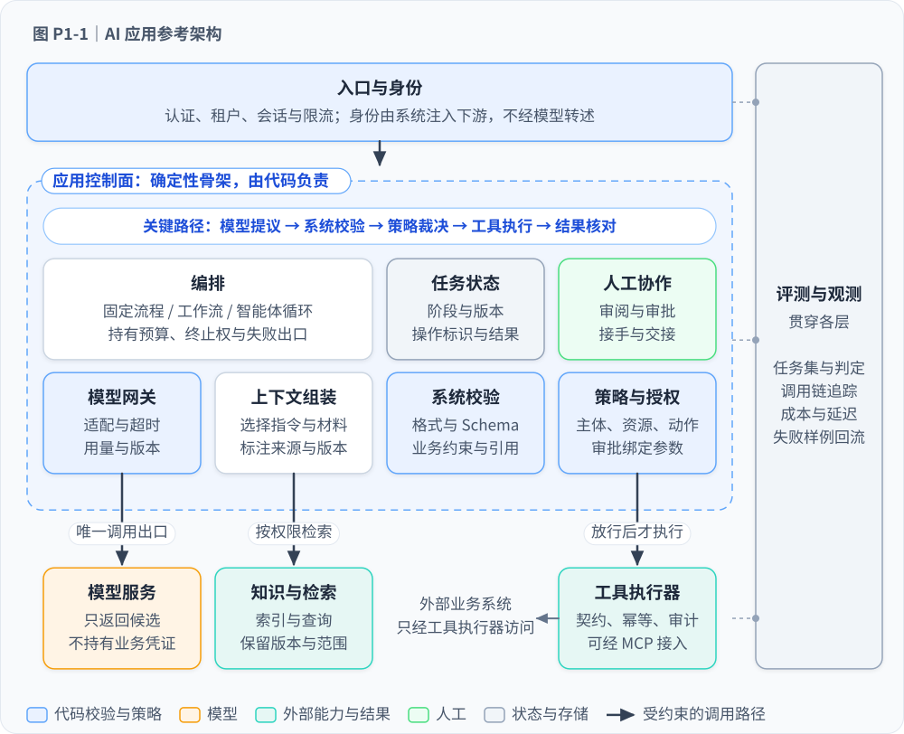

# 第一篇小结：参考架构与完整示范

> **已有经验**：参考架构、组件职责划分与方案评审。
>
> **新增问题**：模型、知识和工具接入以后，各组件的职责怎样分配，第一版又该取用哪些部分。
>
> **本篇产出**：一张标出组件取舍的架构草图，以及一份按十二项写完的标准一页方案。

后端架构师拿到需求能很快给出方案，靠的是一张熟悉的参考架构（接入层、服务层、存储、消息、监控）和一套固定的提问顺序。第 1—3 章分别讨论了控制权、决策方法和语义边界，本篇把它们收拢成同样可用的两样东西：

1. **参考架构**（P1.1—P1.3）：AI 应用由哪些组件构成，各自负责什么，第一版可以省略什么。
2. **完整示范**（P1.4—P1.5）：用一个前文没有出现过的需求，按标准一页方案的十二项从头写到尾。

设计时常用的十种控制与组合模式，收在[附录 F 模式速查](../appendix/patterns.md)。示范中提到“模式 2”“模式 8”等编号时，指的就是附录 F 中的编号。

本篇的组件划分、报销助手需求与全部结论都是教学设计，不是已上线项目的复盘。

## P1.1 参考架构

**要解决的问题**：一个 AI 应用由哪些组件构成，模型处在什么位置？

**读图**：图 P1-1 把 AI 应用分为四部分：入口与身份、应用控制面、能力接入、评测与观测。模型和外部能力都挂在应用控制面上，由代码决定调用顺序、校验结果和授权动作。底部的关键路径就是第 1 章的“模型提议，系统校验，策略裁决，工具执行”；右侧的评测与观测贯穿所有层次。

### 组件职责与后端对应

| 组件 | 职责 | 对应的后端经验 |
| --- | --- | --- |
| 入口与身份 | 认证、租户、会话、限流 | API 网关、认证中间件 |
| 编排 | 决定步骤顺序、何时调用模型、何时停止 | 应用服务层、工作流引擎 |
| 上下文组装 | 为本次调用选择指令、材料和工具说明 | 查询聚合、DTO 组装 |
| 模型网关 | 供应商适配、超时、限流、重试、用量与版本记录 | RPC 客户端、出口网关 |
| 系统校验 | 格式、业务约束、引用关系、截断与拒绝 | 入参校验、反序列化 |
| 策略与授权 | 主体能否对资源执行动作，是否需要审批 | RBAC、ABAC、审批流 |
| 任务状态 | 阶段、版本、待执行动作、操作标识、执行结果 | 业务表、状态机 |
| 人工协作 | 审阅、审批、接手与交接 | 工单与审批系统 |
| 知识与检索 | 文档处理、索引、按权限查询 | 搜索服务 |
| 工具执行器 | 工具契约、参数、超时、幂等、审计、结果规范化 | 外部服务适配器 |
| 模型服务 | 生成候选内容 | 外部依赖 |
| 评测与观测 | 任务集、判定、调用链追踪、成本与延迟 | 测试、监控、日志 |

后端经验大多可以直接迁移，但每个组件都多出一个需要补充的问题：

- **入口与身份**：身份由系统注入下游，不经提示由模型转述。
- **编排**：采用智能体循环时，部分顺序由模型提议，编排层仍要判断进展并持有终止权。
- **上下文组装**：材料要带来源与版本；材料放进上下文，模型也可能没有正确使用它。
- **模型网关**：拿到响应只说明调用成功，内容还要校验。
- **系统校验**：能检查结构与可枚举的约束，语义正确性交给评测与人工审阅。
- **策略与授权**：提议者变成了模型，参数要按不可信输入重新校验。
- **任务状态**：与对话历史分开保存（第 3 章 3.4 节）。
- **人工协作**：审批绑定具体动作与参数版本。
- **知识与检索**：检索到的材料还要判断是否适用。
- **工具执行器**：调用由模型提议，工具描述本身也是模型的输入。
- **模型服务**：输出具有概率性，版本变化可能改变行为。
- **评测与观测**：单元测试验证程序逻辑，评测验证任务质量，两者各管一层。

图中的方框表示职责，不是部署单元。第一版里，编排、上下文组装和系统校验通常只是同一个服务中的几个函数。

## P1.2 第一版只取其中一部分

**要解决的问题**：参考架构是完整形态，第一版该建哪些组件？

第一版按需求取用组件，其余组件在出现明确信号时再加入：

| 组件 | 第一版的最小做法 | 加强的信号与章节 |
| --- | --- | --- |
| 编排 | 普通函数中的固定流程 | 需要等待或审批：工作流（第 12 章）；路径依赖新证据：智能体循环（第 10 章） |
| 上下文组装 | 一个拼装函数，材料带稳定 ID | 材料超出预算，或多轮对话出现信息漂移（第 8 章） |
| 模型网关 | 一个实现模型接口的适配器（第 4 章） | 接入多个模型或供应商（第 22 章） |
| 系统校验 | Schema 加业务校验函数（第 5 章） | 始终需要 |
| 策略与授权 | 只读，复用现有权限系统 | 出现写操作或敏感数据（第 7、21 章） |
| 任务状态 | 无状态请求 | 多步、可中断或有副作用（第 11 章） |
| 人工协作 | 结果标记为待审阅草稿 | 业务要求审批，或需要人工接手（第 12 章） |
| 知识与检索 | 不建，由调用方提供材料 | 评测显示主要缺口是文档知识（第 9 章） |
| 工具执行器 | 不建，或加入固定查询步骤 | 需要实时数据或执行动作（第 7 章） |
| 评测与观测 | 覆盖正常、缺失、冲突材料的样例（第 6 章） | 准备发布和上线运行（第 20 章） |

表中的第 10—13 章与第 20—22 章正在撰写。第 5 章的告警助手就是这样的第一版：固定流程、上下文组装、模型适配器、系统校验和评测样例，其余组件暂时留空。

## P1.3 工具接入协议：MCP 在架构中的位置

**要解决的问题**：通过 MCP 接入的工具，是否改变上面的职责划分？

Model Context Protocol（MCP）是一项开放协议，规定 AI 应用与提供上下文和能力的服务器之间如何通信。协议基于 JSON-RPC 2.0 消息，参与方分为主机（发起连接的 AI 应用）、客户端（主机中的连接器）和服务器（提供能力的服务）。服务器可以提供三类能力：资源（供用户或模型使用的数据）、提示模板，以及供模型调用的工具。[MCP 规范](https://modelcontextprotocol.io/specification/latest)

在参考架构中，MCP 属于工具执行器和知识接入的连接方式：它统一了能力的发现和调用格式，让同一个工具服务器可以被多个应用复用，其他组件的职责保持不变。规范明确说明，协议本身无法在协议层强制执行用户同意、数据隐私和工具安全等原则，要求实现者在应用中建立授权流程和访问控制；规范还要求，除非来自可信服务器，工具行为的描述应视为不可信。

因此设计时按以下方式处理通过 MCP 接入的工具：

- 工具调用照常经过系统校验、策略与授权，审批规则与接入方式无关。
- 工具描述和返回内容按外部输入处理，调用者的权限不因接入而扩大。
- 写操作的幂等、结果核对与审计，仍按[工具契约模板](../appendix/templates/tool-contract.md)逐项确认。

## P1.4 完整示范：报销助手

**要解决的问题**：拿到一个陌生需求，怎样按标准一页方案的十二项写出第一版？

十二项的定义见[第 2 章 2.4 节](02-architecture-matrix.md)。下面按四组顺序逐项填写。

> 员工上传发票照片，系统自动识别并填写报销单，检查是否符合差旅制度，然后提交审批。员工也可以询问报销制度。

### 第一组：问题（第 1、2 项）

**1 任务与交付物。** 这个需求包含两个交付物：

- 预填好的报销单草稿，由员工核对后提交；
- 制度问题的回答，附带制度条款出处。

使用者是员工。审批人继续使用现有审批系统，本应用不改变审批环节。

**2 错误后果与边界。**

| 错误 | 后果 | 处理边界 |
| --- | --- | --- |
| 金额或日期识别错误 | 员工可以发现并修改 | 提交前必须由员工确认 |
| 制度判断错误 | 可能多报，或被错误提示不合规 | 审批人和财务规则把关，系统提示只作参考 |
| 代员工提交，或替审批人决定 | 越权 | 不可越过：系统不自行提交，也不批准报销 |

### 第二组：方案（第 3—5 项）

**3 无需模型的基线。**

- **字段填写**：现有表单手工填写。如果发票以带结构化数据的电子文件提供，直接解析文件比识别图片更可靠，应优先使用。
- **制度检查**：限额、出差地分类、票据类型等可以写成规则，由规则程序检查。
- **制度问答**：基线是制度文档全文搜索。

需要模型补充的能力集中在两处：从图片中抽取字段，以及理解口语化的制度问题并解释条款。

**4 模型职责。**

- 从发票图片中抽取指定字段。这里要与专门的文字识别服务对比，两者都是候选。
- 理解员工的口语问题，并基于检索到的条款解释。

模型不承担的职责：计算限额、给出是否合规的最终结论、提交报销单。

**5 控制方式。**

| 部分 | 选择 | 不选的方案及理由 |
| --- | --- | --- |
| 分流 | 界面提供“填报销单”和“问制度”两个入口 | 不用模型路由（模式 3）：入口已能准确分流 |
| 填报 | 提示链（模式 2）：抽取 → 字段校验 → 制度规则检查 → 生成草稿 | 不用智能体循环（模式 7）：步骤固定 |
| 提交 | 员工确认后提交（模式 9，确认者是员工本人） | 不自动提交：属于越权边界 |
| 问答 | 检索增强生成（模式 8） | 不用多智能体：没有需要隔离的独立职责 |

### 第三组：边界（第 6—9 项）

**6 信息获取。**

- 发票图片：员工上传。
- 差旅制度：检索，按员工所属公司与职级选择适用版本，并保留条款版本；旧版只作历史参考。
- 员工信息与审批人：组织人事系统的权威接口，不从历史记忆读取（第 3 章迁移练习）。

**7 数据处理。** 发票图片含个人与企业信息。发往模型服务前，核对处理位置、第三方接收者、留存期限与用途（[附录 D](../appendix/compliance-cn.md)）；处理条件确认前，原型使用合成或脱敏样例。

**8 动作与授权。**

- 创建草稿：应用内部写入，只影响本应用数据。
- 提交审批：员工确认后，应用以员工身份调用审批系统。这是写操作，携带操作标识，按工具契约确认幂等与结果查询方式。

**9 状态与失败。** 需要保存的状态：草稿字段及每个字段的来源（识别结果或员工修改）、提交状态、操作标识。

| 情况 | 用户看到什么 |
| --- | --- |
| 图片无法识别 | 提示重新拍摄，或转为手工填写 |
| 字段校验不通过，如金额与合计不符 | 标出该字段，要求员工确认 |
| 制度规则判定超限 | 显示命中的规则和条款，员工可补充说明后提交 |
| 问答没有检索到适用条款 | 说明没有找到依据，给出财务咨询入口 |
| 提交超时 | 按操作标识查询审批系统结果，确认前不重复提交 |

### 第四组：验证（第 10—12 项）

**10 评测验收。**

- 抽取样例：清晰发票、模糊或倾斜图片、一张图中有多张发票、外币发票、手写内容。按字段逐项比对，由程序判定。
- 问答样例：有明确条款、多个条款相互冲突、没有相关条款。由熟悉制度的人工按条款判定。

**11 成本与延迟。** 每张发票一次抽取调用，每个问题一次检索与一次生成；按所选服务的实际计价估算，原型完成后用实测替换。延迟按“上传到看到草稿”的起止点测量。

**12 最小实验与改变条件。**

- 与基线比较：员工填写耗时、提交前修改的字段数、被退回的报销单数。
- 推翻条件：如果专门的文字识别服务加规则在字段准确率上不低于模型方案，抽取环节改用文字识别服务。
- 改变架构的需求变化：见 P1.5。

### 得到的架构

对照图 P1-1，第一版使用：编排（固定流程）、上下文组装、模型网关、系统校验、策略与授权（复用现有权限，提交环节绑定员工身份）、任务状态（草稿与提交状态）、知识与检索（制度文档）、工具执行器（审批系统提交接口），以及评测样例。智能体循环和多智能体都不在第一版中。

## P1.5 需求变化时方案怎样调整

**要解决的问题**：第 12 项写下的“改变条件”真的出现时，方案改哪里？

**变化一：财务希望系统协助审核异常报销，例如重复报销或拆分报销。** 重复检测用规则和数据查询完成，模型用来解释可疑记录。如果审核需要根据线索追查多笔历史记录，并且下一步查询取决于上一步的结果，再评估只读范围内的智能体循环（模式 7）。审核结论只给审核人参考，批准和驳回仍由人决定。

**变化二：员工说“把上周北京出差的票都报了”。** 改用计划-审核-执行（模式 10）：模型根据已上传的票据生成待报销单列表作为计划；员工确认后，工作流按计划逐张创建并提交。执行中发现票据已被报销等条件变化时，停止并回到计划阶段。

两次变化都只改动了第 5、8、9 项，第 1—4 项的结论保持不变。这正是把方案写成十二项的用处：变化发生时，可以定位要重写的那几项。

## 本篇小结

1. 参考架构把 AI 应用分为入口与身份、应用控制面、能力接入、评测与观测四部分；模型和外部能力都挂在控制面上。
2. 后端组件的经验大多可以迁移，每个组件多出的问题集中在“提议者变成了模型”这一点上。
3. 第一版按需求取用组件，其余组件等出现明确信号再加入。
4. MCP 统一了工具的发现和调用格式，校验、授权与审批仍由应用负责。
5. 标准一页方案按问题、方案、边界、验证四组共十二项书写；需求变化时，只需重写受影响的项。

下一篇从第 4 章开始，把告警助手的第一版真正实现出来。

## 资料与适用范围

MCP 规范于 2026 年 10 月 21 日核对，引用的是核对当日的最新版本，具体传输方式与扩展能力以接入时的规范版本为准。参考架构的组件划分、组件与后端经验的对应，以及报销助手案例，均为本书的设计方法与教学构造，没有对应的实验结论。

## 迁移练习

社区医院希望做一个出院随访助手：患者在手机上填写症状问卷并可以补充文字描述，系统整理成摘要给护士；出现异常时提醒护士电话回访；患者也可以询问用药注意事项。请用标准一页方案的十二项写出第一版，并说明使用了附录 F 中的哪些模式。

### 参考思路

**当前选择**：问卷用结构化表单；异常判定使用由医护人员制定的规则，模型只负责整理自由文字和生成摘要（模式 2）；提醒护士通过固定工作流完成。用药问答采用检索增强生成（模式 8），只检索医院审定的材料，超出材料范围时转人工。

**需要追问**：异常规则由谁制定和维护？自由文字中出现急症描述时怎样处理，是否需要立即提示就医并通知护士？健康信息属于敏感个人信息，数据处理位置、同意方式和留存期限是什么（附录 D）？

**暂不采用的方案**：模型不判断是否异常，也不给出诊断；流程固定，不使用智能体循环；患者个人记录不进入用药问答的文档索引。

**改变选择的条件**：如果医院希望系统根据回答追加个性化追问，可以评估计划-审核-执行（模式 10），由护士审核追问计划后再发送；判断和处置仍由医护人员负责。
