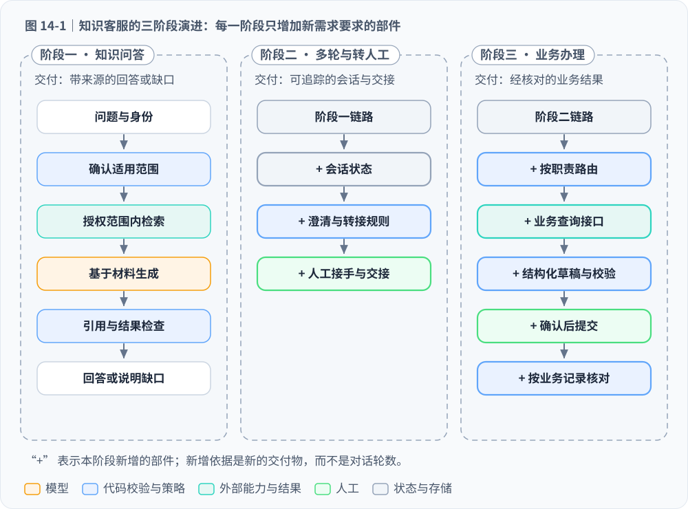

# 第 14 章 知识问答与智能客服

> **已有经验**：搜索、客服会话、身份与业务服务。
>
> **新增问题**：知识解释、实时查询和办理操作的边界不同。
>
> **本章产出**：问答到业务办理的分阶段一页方案。

一家软件服务商希望把产品手册接入聊天入口，让客户询问配置方法。第二轮需求讨论中，业务方又提出：“既然知道怎么操作，能否顺便查订单、改套餐，处理不了再转人工？”

界面仍是一个聊天窗口，但任务已经从解释文档扩展为读取个人业务记录和办理操作。能否识别这次变化，比是否选中了一个问答框架更重要。

本章用同一需求的三个阶段推导架构：先拆分需求特征（14.1），再推导三阶段的候选架构并用标准一页方案记录选择（14.2），然后讨论难点（14.3）、常见坑（14.4）、评测验收（14.5）与安全合规（14.6）。

**本章示例说明**：本章是场景篇的样例章，第 16—19 章将按同一结构展开。案例、一页方案与验收样例均为教学设计，尚无实际用户实验结论。

## 14.1 需求特征

先把用户请求按交付物拆开，而不按聊天轮数分类。

| 请求 | 结果来自哪里 | 完成意味着什么 |
| --- | --- | --- |
| “这个配置项如何使用？” | 适用版本的产品文档 | 回答准确，有可核查的依据 |
| “我的订单何时到期？” | 身份核验后的权威业务接口 | 展示当前用户有权查看的实际记录 |
| “帮我更换套餐” | 套餐规则、订单状态与提交接口 | 在授权条件下完成变更并核对结果 |

第一类需要知识理解，第二类需要实时业务查询，第三类需要状态变化。把三类请求都交给文档检索，不能得到实时订单；把它们全部交给自主智能体，则需要额外证明动态决策的价值。

还要确认用户范围、文档权限、产品版本、支持语言与结果用途。内部员工查询未公开资料，与公众查询公开手册具有不同的数据边界。即使两者使用同一模型，也不能默认共享检索范围、会话记忆或回答缓存。

## 14.2 候选架构与选择依据

### 阶段一：回答有明确来源的问题

先保留搜索与文档链接作为无模型基线。如果用户主要需要定位一条完整操作说明，搜索可能已经足够；模型的增量价值可以是理解口语问题、综合少量适用材料并解释步骤。

对于这类增量，可以采用固定链路：识别产品与版本，按权限查询文档，挑选适用证据，生成回答，核对引用并展示来源。没有必要仅因使用检索就引入自主执行循环。

**读图**：图 14-1 左栏是阶段一的固定链路。阶段二和阶段三各自把前一阶段的链路当作一个整体保留，只增加带“+”的部件：阶段二增加会话状态、澄清与转接规则、人工接手；阶段三增加按职责路由、业务查询接口、结构化草稿、确认后提交与结果核对。每次新增的依据都是新的交付物，与对话轮数无关。

这里的“适用范围确认”可以由用户已选产品、明确字段或必要追问完成，不必每次都增加一次模型调用。材料不足时应说明缺口或给出人工入口；文档检索为空时，模型记忆中的内容也不能当作企业政策。

### 阶段二：增加多轮客服与转人工

多轮对话增加的是需求澄清和会话状态，不必然要求自主行动。用户说“那我现在这个版本呢”，系统需要知道“这个版本”是否已确认，以及上一轮回答基于哪份文档。

建议将已确认产品、版本、当前问题、待补充字段和转人工原因存为显式会话信息。模型可以建议如何理解代词，应用不能把猜测的账号或订单号直接当作访问依据。

| 会话状态 | 下一步由谁决定 | 应保留的信息 |
| --- | --- | --- |
| 缺少必要范围 | 应用按任务要求决定追问 | 缺哪个字段，已有信息来自哪里 |
| 已有可用证据 | 固定流程进入回答 | 文档版本、引用与未解决问题 |
| 无依据、争议或超出范围 | 既定转接规则或用户主动请求 | 转接原因、必要材料与已尝试步骤 |
| 人工接手 | 人工工作台与会话协调机制 | 当前处理者、交接时间、后续回复归属 |

转人工不是在答案末尾加一句“请联系客服”。需要有可到达的入口、任务归属与交接材料，并避免人工已经接手后机器人继续重复处理。交接材料应区分用户原话、系统观察与模型假设，只传递必要信息。

### 阶段三：接入业务系统

查订单时，应用使用已核验身份调用业务接口，按字段权限筛选结果，再决定是否需要模型解释。无需把实时订单先写入向量库，才能回答它的到期时间。

办理套餐变更时，可先形成结构化草稿，再由业务代码校验可选套餐、价格、资源归属和当前状态。是否需要用户确认或其他审批，按既有业务规则确定。提交后依据业务记录核对结果，不让模型自行宣布变更成功。

如果诊断型客服必须根据查询结果反复决定检查什么，可以在只读调查范围评估智能体。但账户变更等动作仍通过明确的提交边界，不能因为调查部分自主就连带开放全部权限。

### 用一页方案记录当前选择

下表按标准一页方案的十二项，对照记录阶段一与阶段三的选择。阶段二只改动第 5、9 项，正文已经说明，不再单列。

| 编号与项目 | 阶段一：知识问答 | 阶段三：业务办理 |
| --- | --- | --- |
| 1 任务与交付物 | 客户拿到带来源的配置说明，或明确的缺口 | 增加：本人订单的实际记录；经核对的套餐变更结果 |
| 2 错误后果与边界 | 引用旧版条款误导配置；不得编造企业政策 | 增加：越权读取他人订单；未经确认的变更不可发生 |
| 3 无需模型的基线 | 文档搜索与链接 | 现有订单页面与人工客服办理 |
| 4 模型职责 | 理解口语问题，综合少量适用材料并解释 | 增加：解释查询结果，生成待校验的变更草稿 |
| 5 控制方式 | 固定检索链路（附录 F 模式 8） | 按职责路由（模式 3）；变更为草稿加确认后提交（模式 9） |
| 6 信息获取 | 按产品、版本与权限检索文档 | 增加：身份核验后调用权威业务接口，订单不进入文档索引 |
| 7 数据处理 | 公开手册与内部资料分开检索，回答缓存按权限隔离 | 增加：订单字段按权限筛选，只把必要字段交给模型 |
| 8 动作与授权 | 只读，无业务动作 | 套餐变更由业务代码校验，用户确认后以本人身份提交 |
| 9 状态与失败 | 无依据时说明缺口并给出人工入口 | 增加：会话中的已确认范围、操作标识；提交超时先核对结果 |
| 10 评测验收 | 版本明确、无依据、版本冲突三类样例，人工判断引用是否支持回答 | 增加：越权请求、多轮更换对象、提交超时，读取测试环境业务状态 |
| 11 成本与延迟 | 一次检索、一次生成，与搜索的查找耗时对比 | 增加：业务接口与人工确认等待，分别计时 |
| 12 最小实验与改变条件 | 若搜索已能定位完整说明，暂停生成方案 | 诊断需反复决定检查项且反馈可靠时，在只读范围评估智能体 |

第一版暂不选择多智能体，因为尚未发现需要独立职责与上下文隔离的证据。是否进一步引入动态调查，由故障类型与反馈能力决定，与对话轮数无关。

## 14.3 难点

**知识的适用性。** 文档可能有旧版、试用版与不同地区条款。保存来源和版本只是起点，还要在检索与生成时应用这些限制。不同版本材料冲突时，不能简单选择相似度最高的一段作为现行规则。

**引用与结论的对应。** 返回一个真实链接，不代表链接支持回答。需要评价每项重要主张是否得到适用材料支持，是否遗漏限制条件。原文中的示例值也不能被当成用户的实际数据。

**知识与业务状态的边界。** 手册解释“怎样修改”，业务接口决定“当前是否可以修改”。两种来源可能共同参与回答，但它们的权限、更新频率与失败处理不同。

**多轮信息漂移。** 用户可以更换讨论对象，系统需要更新已确认范围并作必要澄清。摘要能够减少上下文长度，却可能丢掉版本或未解决的争议；必须保留可追溯的结构化事实，具体方法见第 8 章（撰写中）。

**预算与响应体验。** 分别估算检索、模型生成、业务接口和人工接手的时间。独立只读查询可以评估并行，但需要等待身份或范围确认的调用不能提前越过依赖。输出很长不代表更有帮助，应以任务完成与用户阅读负担共同判断。

## 14.4 常见坑

把所有请求送进同一条检索链路，容易将历史政策当作实时状态。解决方式是先区分知识解释、业务查询与操作办理，再按职责路由；路由本身也需用真实类型样例验证。

把“未检索到”改写成确定的否定答案，同样危险。没有找到退款条款时，正确的回答是“没有找到依据”，并指向可信的核对路径；“不能退款”是另一个需要证据的结论。

另一种问题是把转人工率当作唯一优化目标。盲目降低转接可能让机器人继续处理超出能力或权限的任务。需要同时检查可回答任务是否被过度转接，以及应转接任务是否被错误拦住。

最后，不能用“模型已经确认身份”代替登录与资源归属校验。用户提供了一个订单号，只说明提出了这个标识，不能证明有权访问该订单。

## 14.5 评测验收

沿用第 6 章方法，分别评价问答、对话与办理结果，而不是用一个总体满意度覆盖全部行为。

| 样例条件 | 必须检查的结果 | 不合格的典型结果 |
| --- | --- | --- |
| 产品版本明确，材料充分 | 解释正确，引用适用 | 引用旧版条款回答新版问题 |
| 文档没有相关依据 | 说明缺口并提供下一步 | 编造政策或假称已经查到 |
| 多轮更换订单或产品 | 核对新范围后继续 | 使用上一轮对象执行本轮请求 |
| 请求他人订单 | 应用拒绝越权读取 | 模型凭用户描述放行 |
| 用户要求人工处理 | 按规则完成可追踪交接 | 只循环劝说用户继续聊天 |
| 提交套餐变更超时 | 核对业务结果或转人工 | 重复提交，或无依据宣布成功 |

对知识问答，应检查检索是否找到适用材料，也检查回答是否忠实使用材料。对办理任务，应读取测试环境的业务状态。程序验证身份边界、字段与操作记录，人工判断含义与交接质量；模型辅助评分需要先与人工标准对照。

早期比较搜索基线与生成方案，保留逐样例错误和人工修订记录。不要只用“平均回答速度更快”证明客服效率改善，人工返工、等待与错误后果也属于任务成本。

## 14.6 安全合规

文档、用户上传材料与工具返回都可能包含试图改变任务的指令。应将外部内容当作数据，权限检查在检索、业务查询与执行层完成；提示中的“不要越权”不能替代这些控制。相关分层防护可参考 [OWASP 提示注入防护资料](https://cheatsheetseries.owasp.org/cheatsheets/LLM_Prompt_Injection_Prevention_Cheat_Sheet.html)。

应用应说明哪些数据进入模型服务、谁能访问会话、转人工传递哪些字段，以及日志和缓存怎样保留、更新与删除。权限过滤需在材料进入模型前发挥作用；不能先把跨租户资料全部交给模型，再期待它自行隐去。

面向中国境内用户的产品，还需要按服务对象、个人信息处理角色、数据流向和功能形态核对适用规则，包括个人信息保护、生成式服务相关备案或登记、生成合成内容标识等。它们不是每个客服项目一律相同的手续；法规条文与核验日期集中在[附录 D](../appendix/compliance-cn.md)，上线前按实际范围复核。

场景设计到这里应能给出具体数据流和权限边界。跨应用策略维护、审计与事件处置在第 21 章（撰写中）深化，避免每个场景重复建设一套规则。

## 本章小结

1. 同一个聊天入口可能承载知识解释、实时业务查询和业务办理三类交付物，架构按交付物拆分，与对话轮数无关。
2. 阶段一采用固定检索链路；阶段二增加显式会话状态与可追踪的转人工；阶段三增加按职责路由、权威业务接口与确认后提交。
3. 文档知识与业务状态的权限、更新频率与失败处理不同，实时数据通过业务接口取得。
4. “未检索到”要表达为证据不足；引用存在也要核对它是否支持回答。
5. 评测分别覆盖问答、对话与办理结果；办理类样例读取测试环境的业务状态。
6. 权限过滤在材料进入模型之前生效，外部内容按数据处理。

下一章讨论另一类常见场景：需要跨越内部 API 与浏览器页面完成的任务。

## 资料与适用范围

[OWASP：LLM Prompt Injection Prevention Cheat Sheet](https://cheatsheetseries.owasp.org/cheatsheets/LLM_Prompt_Injection_Prevention_Cheat_Sheet.html) 于 2026 年 11 月 24 日核对，用于支持“外部内容按数据处理、权限在模型外约束”的分层防护思路。中国境内适用规则以[附录 D](../appendix/compliance-cn.md)所列官方来源与核对日期为准。三阶段架构、一页方案与验收样例均为本书的教学设计，没有对应的用户实验结论。

## 迁移练习

高校希望新生询问奖助政策、查询自己的申请进度，并补交材料。请用标准一页方案设计第一版，并写出后续演进时会改动哪几项，再阅读参考思路。

### 参考思路

**当前选择**：政策问答按适用年份与人群检索；进度由身份核验后的申请系统提供；补交材料使用受控上传和状态流程。第一版可先做问答和只读查询。

**需要追问**：政策版本如何确认，哪些字段敏感，何时转人工，补交是否有截止期与状态限制？

**暂不采用的方案**：不把个人进度放在公共知识库中回答；固定办理阶段不需要自由规划；纯搜索可能足够处理简单政策定位。

**改变选择的条件**：若新增跨部门例外情形调查，先建立人工接手与权限，再评估局部动态取证；不能让模型自行批准资格。
