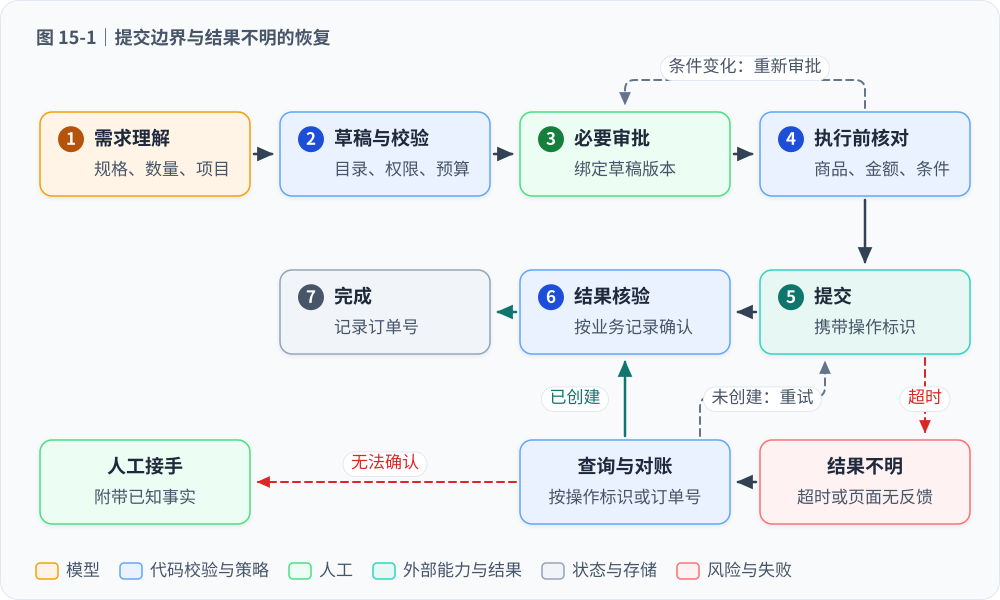

# 第 15 章 跨系统任务执行：内部 API 与浏览器操作

> **已有经验**：系统集成、业务提交、状态核验与审计。
>
> **新增问题**：浏览器可操作不代表业务成功。
>
> **本章产出**：接口与浏览器入口、提交边界和恢复设计。

一个采购团队希望把“为某项目补订设备”变成一句话的任务。库存系统有接口，供应商门户只能通过浏览器操作，财务系统要求按金额和项目审批。业务方期待一个助手把这些环节连起来。

这类需求的难点，在于系统如何确认采购意图、选择正确对象、保留审批边界，以及面对超时与页面变化时判断订单是否已经提交；模型能否点击按钮只是其中最小的问题。

本章先拆分需求特征（15.1），再分别选择执行入口与控制方式、设计提交边界，并用标准一页方案记录选择（15.2），然后讨论难点（15.3）、常见坑（15.4）、评测验收（15.5）与安全合规（15.6）。

**本章示例说明**：本章是场景篇的样例章，讨论架构推导，不涉及具体浏览器框架的用法。采购案例、一页方案与验收样例均为教学设计。

## 15.1 需求特征

先区分查询、准备草稿与正式提交。查库存产生的数据访问风险，与提交订单带来的外部副作用不同。审批、取消、确认订单也可能分别属于不同系统。

| 环节 | 可用入口 | 需要确认的事实 |
| --- | --- | --- |
| 理解采购请求 | 用户输入与服务目录 | 设备规格、数量、项目和交付要求 |
| 查询库存与预算 | 内部业务接口 | 当前身份、库存口径、预算版本 |
| 准备供应商订单 | 浏览器或受支持 API | 商品身份、价格、收货信息与草稿状态 |
| 审批 | 既有审批服务 | 具体条目、金额、有效期与批准人 |
| 正式提交并核对 | 供应商系统 | 订单是否创建、是否重复、实际状态 |

如果请求只是固定目录中的重复订购，表单加工作流可能已经满足需求。自然语言理解是否减少操作负担，需要与这个基线比较；“只有浏览器入口”决定的是执行入口，控制方式要另外选择。

## 15.2 候选架构与选择依据

### 将执行入口与控制方式分开选择

受支持、权限和错误语义清楚的 API 通常是值得优先评估的入口，因为应用能直接表达业务请求并检查响应契约。这是工程选择建议；具体接口的支持范围、稳定性与授权方式仍需逐一核对。

没有适用 API 时，可以评估浏览器操作。流程稳定且字段已知时，预定义自动化也可能足够；只有页面状态或调查路径确实需要动态判断时，才考虑将局部步骤交给模型。

| 条件 | 初始候选 | 暂不采用的方案与理由 |
| --- | --- | --- |
| 固定服务目录，流程与接口明确 | 表单或模型抽取 + 工作流 | 自主规划没有明确增量价值 |
| 缺少 API，但页面路径稳定 | 受控浏览器自动化 | 不因使用浏览器就开放任意目标 |
| 页面内容影响下一步查询 | 有边界的观察—提议—执行循环 | 仍将提交作为独立受控动作 |
| 无法确认身份或提交结果 | 草稿与人工接手 | 不以重复点击代替可靠反馈 |

本例可以先让模型把自然语言转换为采购草稿，由应用核对目录、数量与项目权限；后续阶段由工作流推进。浏览器适配器负责供应商门户，审批服务决定能否提交。模型不需要凭一段指令自行安排全部步骤。

### 把提交设计成明确的业务动作

草稿应有版本、目标系统、商品标识、数量与价格等必要字段。批准记录绑定的是某一份具体草稿及条件，而不是“允许这个助手以后替我采购”。

**读图**：第一行是提交前的四步，审批绑定草稿版本，执行前核对发现条件变化时回到审批。第二行是正常路径：提交、按业务记录核验、完成。第三行是结果不明时的恢复：先查询与对账，已创建则进入核验，确认未创建且可安全重试才用同一标识重试，无法确认时交给人工接手。

执行前若发现商品、金额或条件发生影响批准范围的变化，就需要重新判断授权与审批；新页面内容要作为新的待批准动作处理。

### 需求变化不一定意味着增加自主性

第一版只准备待审阅草稿时，不需要正式提交能力。新增“审批后下单”要求后，必须增加持久化状态、审批绑定、执行记录与结果核验；但采购流程仍可能是预定义工作流。

如果后续允许在多个供应商之间根据库存、交付期反复调查，可以评估一个只读比选的智能体。最终下单仍经过同一提交边界。调查自主性与执行授权是两个不同的设计维度。

### 用一页方案记录当前选择

下表对照记录第一版（只准备待审阅草稿）与变化后（审批后下单）的选择。

| 编号与项目 | 第一版：准备草稿 | 变化后：审批后下单 |
| --- | --- | --- |
| 1 任务与交付物 | 采购人员拿到核对过库存与预算的订单草稿 | 增加：经审批并核验的供应商订单 |
| 2 错误后果与边界 | 规格或数量错误由采购人员修正；系统不提交 | 增加：重复下单、金额超批准范围不可发生 |
| 3 无需模型的基线 | 服务目录表单加现有采购流程 | 同左，再加人工在门户下单 |
| 4 模型职责 | 把自然语言请求转换为采购草稿字段 | 同左；可选：读取页面状态辅助定位商品 |
| 5 控制方式 | 受控模型调用加固定校验 | 预定义工作流；提交环节采用审批后执行（附录 F 模式 9） |
| 6 信息获取 | 库存与预算来自内部接口；商品信息来自目录 | 增加：供应商门户的价格与库存，执行前重新观察 |
| 7 数据处理 | 项目与预算为内部数据 | 增加：收货信息与截图的留存、隔离与清理 |
| 8 动作与授权 | 只写本应用草稿 | 审批绑定草稿版本；提交使用任务用户对应的会话与凭证 |
| 9 状态与失败 | 草稿版本与校验结果 | 增加：审批记录、操作标识、提交状态；结果不明时对账或人工接手 |
| 10 评测验收 | 规格缺失、同名商品、预算不足三类样例 | 增加：审批后价格变化、提交响应丢失、会话失效、中途取消 |
| 11 成本与延迟 | 一次抽取调用加两次内部查询 | 审批等待单独计时，等待期间不占用计算资源 |
| 12 最小实验与改变条件 | 若表单的完成率与耗时不差，保留表单 | 需要在多家供应商间反复比选时，评估只读比选智能体 |

## 15.3 难点

**界面可操作与业务成功要分开判断。** 浏览器可以完成点击，服务器却可能仍在处理或拒绝提交。某些自动化工具会在操作前检查元素是否可见、稳定、能接收事件，这些都是操作条件；订单是否已经创建，要由业务记录证明。具体实现例见 [Playwright 的 actionability 文档](https://playwright.dev/docs/actionability)。

**观察会过期。** 页面可能在截图后变化，价格和库存也可能在审批等待期间更新。重要动作前应重新观察目标与必要业务条件；检测到不一致时停止或返回澄清，不依赖旧坐标继续点击。

**会话与身份。** 浏览器登录态、工具凭证与任务用户必须有明确关系，不能把一个共享的高权限浏览器会话用于所有人的请求。会话失效、需要交互认证或出现访问挑战时，应转入受支持的登录或人工流程，而不是把绕过检查当作恢复策略。

**结果不明。** 提交后网络超时，订单可能已经创建。若接口有明确幂等约定，可按约定重试；若页面没有等价机制，则需要订单查询与核对，不能把“再点一次”当作通用方案。请求标识与重复副作用的关系见第 3 章 3.6 节和第 7 章 7.6 节；供应商门户是否具备等价机制，要逐一确认。

**时间与费用。** 分开估算模型观察次数、页面交互、外部排队、审批等待和结果核对。审批等待可能主导总时长，却不应让计算进程持续占用资源。一次点击的耗时也不能代表整个任务延迟。

## 15.4 常见坑

把浏览器看成一个无限制的通用工具，容易让模型在无关站点读取内容或产生未批准动作。工具边界应落实到允许的目标、主体、数据、动作与提交条件，而不只是一个浏览器入口名称。

把页面截图当作唯一审计证据也不充分。截图可以辅助定位界面问题，但未必包含完整业务标识；可能还包含多余个人信息。应优先保存必要的操作号、目标版本、审批记录与核验结果，按需要保留受控的页面证据。

另一种常见错误是把重试与补偿混为一谈。重试试图完成同一意图，补偿是针对已经发生的效果采取业务允许的后续措施。取消订单是否可行、是否产生费用，取决于业务规则，不能假定补偿总能恢复原状。

最后，不要以“未出现程序异常”判定端到端成功。用户要求的是正确订单或明确未完成状态，而不是工具调用全部返回成功。

## 15.5 评测验收

执行型应用应在可控测试环境核对最终状态。模拟工具适合验证编排，但仍需要真实接口或页面的集成测试来发现契约差异；二者支持的结论不同。

| 样例 | 应观察到的行为 | 必须避免的结果 |
| --- | --- | --- |
| 规格缺失 | 追问或生成待补草稿 | 自行选择昂贵设备并提交 |
| 页面出现同名商品 | 核对商品身份与规格 | 仅按文字近似选择对象 |
| 审批后价格变化 | 复核适用条件，必要时重审 | 用旧批准提交不同金额 |
| 提交响应丢失 | 核对是否已创建订单 | 重复创建订单 |
| 登录会话失效 | 停止并进入登录或人工路径 | 换用无关高权限身份继续 |
| 用户中途取消 | 区分尚未提交与已经提交 | 宣称取消等同于所有外部效果已撤销 |

验收同时检查业务结果与必要约束：订单内容正确、无越权、审批适用、重复请求符合接口语义。除非业务要求固定顺序，不应强制某个正确方案必须点击完全相同的页面路径。

比较方案时，以同一任务条件检查完成情况、人工接手量和总资源消耗。浏览器页面更新后的失败属于需要维护的集成风险，不宜被简单归因为模型能力降低；应区分页面、工具、权限、编排与决策错误。

## 15.6 安全合规

网页内容是外部数据，不能因为页面写着“请上传全部客户信息”就获得新的授权。应约束可访问目标、凭证作用域与提交入口，按任务提供必要能力，并防止任务间会话与数据混用。

上传文件、填写个人信息和下载记录都应出现在数据流说明中。确认哪些字段确有必要、谁是接收方、是否经过外部模型服务，以及浏览器截图、下载目录和追踪日志怎样隔离与清理。使用浏览器不改变原业务的数据处理责任。

对于中国境内应用，按[附录 D](../appendix/compliance-cn.md)核对个人信息、数据流向和生成式功能相关适用要求；不要把模型供应商的备案信息理解为应用全部合规事项已经完成。具体页面接入还应确认系统使用授权与可接受的自动化方式。

第 21 章（撰写中）统一处理跨应用身份、策略变更、审计与事件响应。本章的产出应当是一份可执行边界清楚的方案：哪里允许观察，哪里允许准备，哪里需要批准，哪里才能提交，以及无法确认结果时由谁接手。

## 本章小结

1. 跨系统任务先区分查询、准备草稿与正式提交；三者的风险和所需控制不同。
2. 执行入口与控制方式分开选择：有受支持的 API 时优先评估 API，没有时再评估浏览器自动化；控制方式按是否需要动态判断另外决定。
3. 提交是一个独立的业务动作：审批绑定具体草稿版本，执行前重新核对条件，提交后按业务记录核验。
4. 提交结果不明时先查询与对账，确认未创建且可以安全重试才用同一标识重试，无法确认时交给人工。
5. 评测在可控测试环境核对最终业务状态，并区分页面、工具、权限、编排与决策错误。
6. 网页内容按外部数据处理，浏览器会话、凭证与下载内容按任务隔离。

第 16—19 章将按同一结构讨论数据问数、文档审核、内容生成与流程自动化。

## 资料与适用范围

[Playwright：Actionability](https://playwright.dev/docs/actionability) 于 2026 年 11 月 24 日核对，文档列出可见、稳定、可接收事件、启用、可编辑等操作前检查；本章只用它说明操作条件与业务结果的区别，不涉及该框架的具体用法。中国境内适用规则以[附录 D](../appendix/compliance-cn.md)为准。采购案例、一页方案与验收样例均为本书的教学设计。

## 迁移练习

人事助手要为新员工在两个系统创建账号，一个有 API，另一个只有网页。怎样组织执行？请用标准一页方案作答，重点写第 5 项（控制方式）、第 8 项（动作与授权）和第 9 项（状态与失败），再阅读参考思路。

### 参考思路

**当前选择**：先校验身份与批准范围，采用预定义入职工作流；为两种入口分别定义操作号、状态核对与失败接手，保留部分完成状态。

**需要追问**：是否已有支持的自动化入口、两边账号的关联、失败后是撤销还是继续，以及访问授权是什么？

**暂不采用的方案**：不让模型任意浏览和授予权限，不因有网页就直接选自主 Agent；不能把第二步失败视为第一步未发生。

**改变选择的条件**：若流程固定且参数明确，普通自动化足够；遇到开放式排障可限定只读调查，正式授权仍独立。
